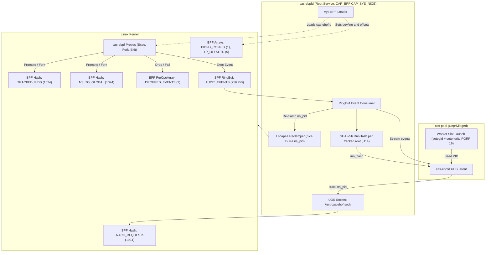

# 0014-ebpf-priority-clamping-and-audit-probes

## Overview

Host `ceres` executes many concurrent agent tasks. Heavy compiler and test workloads must not starve interactive developer shells or Cortex mesh daemons. Spec 0001 invariant 4.2 requires host build throttling. The Failure Matrix specifies clamping build process trees to `nice 19`. This spec defines eBPF tracepoint instrumentation and priority clamping in `cas-ebpf`:
- **CER-2719**: Worker process priority clamping via process groups (`PRIO_PGRP`) and eBPF anti-escape monitoring (`sched_process_exec`, `sched_process_fork`).
- **CER-2720**: Kernel execution audit ring buffer (`ExecEvent` on `sched_process_exec` and `sched_process_exit`) and SHA-256 `run_hash` transcript digest logger. Per operator ruling, `openat` and `connect` are excluded from Phase 2.
- **Privileged Daemon Architecture**: A root systemd service (`cas-ebpfd`) loads BPF programs, owns maps, and serves unprivileged `cas-pool` clients over a Unix Domain Socket (UDS).

Parent tickets: CER-2682, CER-2683. Nested pid namespace fix: CER-2773 (T14, D12). Facts, measured 2026-10-09 on ceres (kernel `6.6.87.2-microsoft-standard-WSL2`):
- **T1: Toolchain Installation [verified]:** `bpf-linker 0.11.1` installed via mise (musl binary, SLSA sha256 `c974140662f783c37bf0267436409caa8f4708ec10b558d9d1c594385489fe2f`). Standard `cargo install` fails without system LLVM 23.
- **T2: Toolchain Inventory [verified]:** `rustup toolchain list` contains stable, nightly, and 1.94.1.
- **T3: Nightly rust-src Component [verified]:** Installed via `rustup component add rust-src --toolchain nightly` (`1.101.0-nightly (ea137335b 2026-10-05)`).
- **T4: Bytecode Compilation [verified]:** `crates/cas-ebpf/ebpf` builds under nightly with `-Z build-std=core` into a 8,568 byte ELF (measured 2026-10-10 after D12; 7,864 before) (`cas-ebpf.o`). Sections: `tracepoint`, `license`, `maps`. No `.BTF` section needed.
- **T5: Subcrate Manifests [verified]:** Subcrate contains independent `Cargo.toml`, `rust-toolchain.toml`, and `.cargo/config.toml` targeting `bpfel-unknown-none`.
- **T6: Autogroup Configuration [verified]:** `CONFIG_SCHED_AUTOGROUP` is NOT set on WSL2 (`/proc/self/autogroup` ENOENT).
- **T7: Tracepoint Layouts [verified]:** Formats on ceres: `sched_process_exec` (`filename` at 8, `pid` at 12); `sched_process_fork` (`parent_comm` at 8, `parent_pid` at 24, `child_comm` at 28, `child_pid` at 44; parent tgid from `bpf_get_current_pid_tgid() >> 32`); `sched_process_exit` (`comm` at 8, `pid` at 24, `prio` at 28). Main thread pid equals tgid.
- **T8: Priority Clamping Behavior on Linux [verified]:** `setpriority(PRIO_PROCESS, tgid, 19)` sets only the main thread ({main: 19, t1..3: 0}). `setpriority(PRIO_PGRP, pgid, 19)` sets all current and future threads to nice 19. Asserted by `crates/cas-ebpf/tests/clamp.rs`.
- **T9: Kernel Capability Requirements [verified]:** BPF loading requires `CAP_BPF`, `CAP_PERFMON`, and `CAP_SYS_NICE`. `kernel.unprivileged_bpf_disabled` is 2.
- **T10: Clean-Room Boundary [verified]:** Clean-room implementation using Aya (`aya 0.14.0`, `aya-ebpf 0.2.1`). Zero code from `neutral-engineering/autonice`.
- **T11: Dual Licensing Position [verified]:** Kernel BPF program declares `Dual MIT/GPL` in `license`. Userspace loader and crate remain proprietary.
- **T12: CI Capability Invariant [verified]:** Unprivileged `ci-rust` embeds committed `cas-ebpf.o`. Live integration tests run via `make ebpf-test` under sudo on ceres.
- **T13: Pid namespaces [verified 2026-10-10, lane w25:p1]:** Host `ceres` runs under a pid namespace (pid 1 is systemd; `/proc/self/ns/pid` inode 4026532221). The sched tracepoint fields and `bpf_get_current_pid_tgid` carry global pids. A `bpf_printk` build showed kernel tgid 2107147 for a process reporting userspace pid 1935786. Therefore, map lookups keyed by userspace pid failed (4 of 8 live gate failures). With the namespace translation architecture, the live gate passes 8 of 8 (`make ebpf-test`, sudo, 2026-10-10). The ELF bytecode size is 7,864 bytes with sha256 `8bdc59b358377b336c6776e10899b69542ad37374ce2e4481e48384d2743e95b`.
- **T14: Nested pid namespaces [2026-10-10]:** The helper `bpf_get_ns_current_pid_tgid` succeeds only when the configured `(dev, ino)` is the exact active pid namespace of `current`; otherwise it returns `-EINVAL` and zeroes its output [reported, torvalds/linux@ffc2532:kernel/bpf/helpers.c lines 582-613, tag v6.6; not re-measured live on ceres]. At 056d7c7, `current_ids()` returns `None` on that failure, and the exec and fork handlers return early [verified, `git show 056d7c7:crates/cas-ebpf/ebpf/src/main.rs`]. So a nested child of a tracked task enters `TRACKED_PIDS` at fork, but its exec is not audited and its own children are not tracked. Exit still removes `TRACKED_PIDS[gpid]`; it skips only the `NS_TO_GLOBAL` and `TRACK_REQUESTS` cleanup.
- **T15: Reachability [2026-10-10]:** An unprivileged task enters a nested pid namespace: lane w25:p1 measured daemon ns 4026532221 and nested ns 4026534408 [reported, CER-2773]. A re-run of `unshare -Upf --fork readlink /proc/self/ns/pid` gave 4026534720, because each run makes a new namespace [verified]. `NSpid` in `/proc/self/status` of the nested task lists two pids, so the task has a pid in the outer namespace that the helper cannot return [verified, `unshare -Upf --fork sh -c 'grep NSpid /proc/self/status'`]. The sandbox launcher unshares `NEWUSER|NEWNET` when a direct `NEWNET` is refused [verified, `git show 056d7c7:crates/cas-sandbox/src/netns.rs`]. That nothing in a slot blocks a further pid unshare is [asserted].
- **T16: Layouts differ by kernel [2026-10-10]:** On the `ci-kernel` node (`6.18.51-talos`), `sched_process_fork` has `__data_loc` comm fields: `parent_comm` at 8, `parent_pid` at 12, `child_comm` at 16, `child_pid` at 20. Its `sched_process_exec` matches ceres (`filename` `__data_loc` at 8, `pid` at 12). Its `sched_process_exit` keeps `comm[16]` at 8 and `pid` at 24, and adds `group_dead` at 32 [verified, `gh run view 38027192645 --job 114140426567 --log`]. Ceres values are T7; tracefs is root-only there, so this lane did not re-read them. The object at `62326b5` reads `child_pid` at the fixed offset 44, which on 6.18 lands in string bytes [verified, `git show 62326b5:crates/cas-ebpf/ebpf/src/main.rs`]. Attempt 1 stopped at the bpf-linker install (no `zstd`, no `sudo`). Attempt 2 loaded that object (sha256 `e49eb9e7c912...`) on 6.18, and `load_attaches_three_tracepoints` passed. 4 of 9 live cases failed, and each one expects the exec of a child forked by a tracked parent (`no exec event for the shell`) [verified, `gh api repos/cerebral-work/cas-substrate/actions/jobs/114141577624/logs`]. That the fork offset is the only cause is [asserted] until D13 runs there.
- **T17: Receipt gap [2026-10-10]:** At commit `ba8d278625bf86f98bfbbb7d2852b80551ffd22c` (S, the PR #57 merge) the daemon answers only `Ack`, `Status` and `Failure`. `drain` keeps the dropped total in a local of the reader task, and `ProbeHandle` reads `DROPPED_EVENTS` slot 0 only [verified, `git show S:crates/cas-ebpf/src/{protocol,daemon,handle}.rs`]. `ExecEvent.ppid` is the `TRACKED_PIDS` value: the `track` ppid for a root, the forking parent's namespace tgid for a child [verified, `git show S:crates/cas-ebpf/ebpf/src/main.rs`]. `kernel.pid_max` on ceres is 4194304 [verified, `cat /proc/sys/kernel/pid_max`].

## Design

### Requirements (EARS)

- **Ubiquitous:** The `cas-ebpf` crate shall implement clean-room eBPF probes using Aya without copyleft dependencies.
- **Ubiquitous:** The root daemon `cas-ebpfd` shall hold `CAP_BPF`, `CAP_PERFMON` and `CAP_SYS_NICE` while serving unprivileged clients over a UDS socket, and shall accept `track` only for a pid owned by the peer's uid.
- **Ubiquitous:** The `cas-ebpf` loader shall configure `PIDNS_CONFIG` with the device and inode of `/proc/self/ns/pid` upon loading the eBPF object.
- **Ubiquitous:** Before it attaches any program, the `cas-ebpf` loader shall parse the `format` files of the three sched tracepoints from tracefs and write five field offsets into `TP_OFFSETS` (D13).
- **Ubiquitous:** The probes shall read a tracepoint field only at the offset in its `TP_OFFSETS` slot, masked with `0xff`, and shall skip that read when the slot holds less than 8 (D13).
- **Event-driven:** WHEN a worker slot spawns, `cas-pool` shall configure a dedicated process group and clamp priority to `nice 19`.
- **Event-driven:** WHEN userspace calls `track(pid, ppid)`, `cas-ebpf` shall record the namespace pid and parent pid in `TRACK_REQUESTS`.
- **Event-driven:** WHEN a tracked process executes `exec` or `fork`, the probe shall translate `current` via `bpf_get_ns_current_pid_tgid`, promote matching `TRACK_REQUESTS` into `TRACKED_PIDS`, and insert the translation into `NS_TO_GLOBAL`.
- **Event-driven:** WHEN a tracked process forks, the probe shall insert the child global pid into `TRACKED_PIDS` with the parent namespace tgid.
- **Event-driven:** WHEN process exec or exit events fire, the eBPF probe shall stream structured `ExecEvent` records and update `run_hash`.
- **Event-driven:** WHEN submitting an `ExecEvent`, the probe shall populate `ns_pid` with the namespace tgid and `pid` with the global tgid.
- **Event-driven:** WHEN a tracked task exits, the probe shall evict its global pid from `TRACKED_PIDS` and, when the task has a namespace pid, evict it from `NS_TO_GLOBAL` and, if group leader, from `TRACK_REQUESTS`.
- **Event-driven:** WHEN a `track` succeeds, `cas-ebpfd` shall drain the ring buffer first, then open a receipt window for the pid, owned by the peer's uid and connection, with the pid as its only member (D14).
- **Event-driven:** WHEN `cas-ebpfd` drains an `ExecEvent`, it shall place the event in the one window whose member set holds its `ppid`, else in the one whose set holds its `ns_pid`; an open window shall absorb it into its `RunHash` in delivery order and add a non-zero `ns_pid` to its set (D14).
- **Event-driven:** WHEN the total of a `DROPPED_EVENTS` slot grows, `cas-ebpfd` shall add the delta to `dropped_events` of every open window (D14).
- **Event-driven:** WHEN a peer sends `receipt` for a window it may read, `cas-ebpfd` shall drain the ring buffer, answer `{"receipt":{...}}` with the window's totals, and leave an open window open (D14).
- **Event-driven:** WHEN a peer sends an accepted `untrack`, `cas-ebpfd` shall drain the ring buffer, then close the pid's window, which absorbs nothing more and stays readable (D14).
- **Event-driven:** WHEN a peer sends an accepted `forget`, or the owning connection closes, `cas-ebpfd` shall discard the window and leave kernel tracking unchanged (D14).
- **State-driven:** WHILE tracking worker processes, `cas-ebpfd` shall read the nice value of every tracked pid that execs and re-clamp it to `nice 19` using a non-zero `ns_pid`.
- **State-driven:** WHILE `PIDNS_CONFIG` contains zeroes (`[0, 0]`), the probes shall use global pids directly without namespace translation.
- **Unwanted behavior:** IF `TRACKED_PIDS` is full during promotion or fork insertion, THEN the probe shall increment `DROPPED_EVENTS[1]` (`tracking_failures`) and leave the process untracked.
- **Unwanted behavior:** IF the ring buffer is full when an exec event occurs, THEN the probe shall increment `DROPPED_EVENTS[0]` (`dropped_events`).
- **Unwanted behavior:** IF `bpf_get_ns_current_pid_tgid` fails for `current`, THEN the probes shall use its global tgid with `ns_pid` 0, keep it in `TRACKED_PIDS`, the audit stream and exit eviction, and shall not read or write `TRACK_REQUESTS` or `NS_TO_GLOBAL` for it (D12).
- **Unwanted behavior:** IF an `ExecEvent` carries `ns_pid` 0, THEN `cas-ebpfd` shall not read `/proc` or call `setpriority` for it, shall stream the record, and shall log it as unresolved.
- **Unwanted behavior:** IF a tracepoint `format` file is missing or unreadable, lacks a D13 field, or gives a field that breaks the D13 type, size or bound rules, THEN `Probes::load` shall return `EbpfError::TracepointFormat` and attach no program.
- **Unwanted behavior:** IF a `track` or `untrack` request names pid 0, THEN `cas-ebpfd` shall refuse it.
- **Unwanted behavior:** IF the `SO_PEERCRED` pid of a peer is absent or 0, or its `/proc/<pid>/ns/pid` differs from the daemon's, THEN `cas-ebpfd` shall answer its first request with `{"ok":false,"error":"peer pid namespace differs from the daemon's"}` and close the connection.
- **Unwanted behavior:** IF a drained event fits no window or more than one, THEN `cas-ebpfd` shall add 1 to `dropped_events` of every open window whose uid is the event's uid or 0 (D14).
- **Unwanted behavior:** IF an absorbed event's `ns_pid` would join a member set that holds 4096 pids, THEN `cas-ebpfd` shall leave the set unchanged and add 1 to that window's `dropped_events` (D14).
- **Unwanted behavior:** IF a `receipt` or `forget` names pid 0, a pid with no window, or, for a non-root peer, a window of another uid, or a `track` names a pid whose window is closed, THEN `cas-ebpfd` shall refuse it; so a `receipt` after `forget` is refused (D14).

### Decisions

| # | Decision | Who, when |
|---|---|---|
| D1 | Clean-room Aya implementation: Build probe loader with `aya` 0.14.0 (MIT OR Apache-2.0). Never import or vendor `neutral-engineering/autonice` (GPL-2.0). | Spec 0004 & the operator, 2026-10-09 |
| D2 | Licensing boundary: The kernel-side BPF program declares `Dual MIT/GPL` in its license section to permit GPL-only BPF helpers. Crate `cas-ebpf` remains proprietary. Subcrate uses `MIT OR Apache-2.0`. | the operator, 2026-10-09 |
| D3 | Compile and packaging boundary: Kernel BPF bytecode crate lives at `crates/cas-ebpf/ebpf` outside monorepo workspace. Pre-compiled object `cas-ebpf.o` is committed next to `cas-ebpf.o.sha256`; `make ebpf-build` rebuilds both (reproducible: two builds on ceres gave the same hash, 2026-10-09). `build.rs` never rebuilds; it refuses to compile the crate when the object and the recorded hash disagree. The crate embeds `cas-ebpf.o` via `include_bytes!`. Workspace builds on stable Rust. The committed `cas-ebpf.o.sha256` is the record of the current object; T13 gives the hash measured 2026-10-10. | CAS lanes, 2026-10-09 |
| D4 | Priority clamping mechanism (R2): `cas-pool` creates a dedicated process group (`setpgid(0, 0)`) for each worker slot and calls `setpriority(PRIO_PGRP, pgid, 19)` once before exec. All threads and child processes inherit nice 19 without privileges or race conditions. | the operator ruling, 2026-10-09 |
| D5 | Narrowed scope & anti-escape monitoring (R1): No host-wide autonice. Clamping applies exclusively to worker process trees that `cas-pool` registers with a `track` request (promoted into `TRACKED_PIDS`, D11). The eBPF probe detects if a child process leaves its group (`setsid` or `setpgid`) and triggers re-clamping. Target compiler basenames serve as optional audit tags. | the operator ruling, 2026-10-09 |
| D6 | Execution audit ring buffer (R4): CER-2720 narrowed to exec and exit events. BPF ring buffer (`AUDIT_EVENTS`, 256 KiB) streams structured 168-byte `ExecEvent` records. Openat and connect are out of Phase 2. | the operator ruling, 2026-10-09 |
| D7 | SHA-256 `run_hash` execution transcript digest (D-E): Incremental SHA-256 digest over 168-byte `#[repr(C)]` little-endian records in ring-buffer delivery order. Serves as execution transcript proof in Saga receipts. Dropped-event counter tracks ring-buffer overflows. | the operator ruling, 2026-10-09 |
| D8 | Privileged daemon architecture (`cas-ebpfd`, R3): A dedicated root systemd unit `cas-ebpfd` runs with `CAP_BPF`, `CAP_PERFMON`, and `CAP_SYS_NICE`. It owns maps and ring buffers, serving unprivileged `cas-pool` over a UDS with strict allowlist (`track`, `untrack`, `stream_events`). `cas-pool` remains unprivileged. | the operator ruling, 2026-10-09; D14 adds `receipt` and `forget` (lane w25:p1, 2026-10-10) |
| D9 | Map lifecycle & eviction (D-F): Loader API provides `track(pid, ppid)`, which writes a `TRACK_REQUESTS` entry (D11), and `untrack(pid)`. `sched_process_exit` evicts the exited task from `TRACKED_PIDS` (1024 entries) by global pid, from `NS_TO_GLOBAL` when it has a namespace pid, and a group leader's request from `TRACK_REQUESTS`, preventing map leaks. | CAS lanes, 2026-10-09; wording amended by lane w25:p1, 2026-10-10 |
| D10 | Dependency pins & error handling: Pinned: `aya = "0.14.0"`, `aya-ebpf = "0.2.1"`, `sha2 = "0.11.0"`, `rustix = "1.1.5"`. Uses `thiserror` for typed `EbpfError`. | Spec 0004 & CAS lanes, 2026-10-09 |
| D11 | PID namespace translation and promotion architecture: The daemon resolves `/proc/self/ns/pid` dev/ino into `PIDNS_CONFIG`. Probes translate via `bpf_get_ns_current_pid_tgid`. Userspace track requests are queued in `TRACK_REQUESTS` and promoted to `TRACKED_PIDS` on first fork or exec, populating `NS_TO_GLOBAL`. `ExecEvent` carries `ns_pid` at offset 164 for userspace re-clamping. | the operator ruling & CAS lanes, 2026-10-10 |
| D12 | Nested pid namespaces (T14, T15): when the helper fails, the probes fall back to the global tgid with `ns_pid` 0, so nested tasks stay tracked, audited and evicted. The fallback never uses 0 as a map key: no `TRACK_REQUESTS` lookup and no `NS_TO_GLOBAL` write or remove, so a nested task is tracked only by fork inheritance. The daemon reports `ns_pid` 0 as unresolved (the task has a pid in the daemon's namespace, but the helper cannot name it), never re-clamps it, and refuses `track` and `untrack` of pid 0. A peer whose `/proc/<pid>/ns/pid` differs from the daemon's, or whose `SO_PEERCRED` pid is absent or 0, is refused, root included. | Lane w25:p1, 2026-10-10, under the land-on-green rule for its own repo; the operator can override |
| D13 | Tracepoint offsets at load (T16). The loader reads `events/sched/<tp>/format` under `/sys/kernel/tracing`, else `/sys/kernel/debug/tracing`. Before the first attach it writes five offsets into `TP_OFFSETS` (`Array<u32>`, 5 slots): 0 exec `pid`, 1 exec `filename`, 2 fork `parent_pid`, 3 fork `child_pid`, 4 exit `pid`. Rules: a pid field is `pid_t` of size 4; `filename` is `__data_loc` (not `__rel_loc`) of size 4, read as a 4-byte loc whose low 16 bits give the string offset; every field has offset >= 8 and offset + size <= 256. The program reads slots 1 and 3 only (`tp_offset` in `ebpf/src/main.rs`). It masks each offset with `0xff` and skips the read when the result is below 8. The loader never writes an offset above 252 for these 4-byte fields (offset + size <= 256, `bounds` in `src/tracefs.rs`), so neither 4-byte read ends past byte 256. Slots 0, 2 and 4 are parsed and checked for later probes. A slot below 8 is unconfigured: fork skips the insert and bumps `DROPPED_EVENTS[1]`; exec leaves `filename` zeroed. A missing or unparsable file is `EbpfError::TracepointFormat`, and nothing attaches. The same masked ctx read (`loc & 0xffff`) already passes the verifier on 6.6 (T13) and 6.18 (T16). | Lane w25:p1, 2026-10-10, under the land-on-green rule for its own repo; the operator can override |
| D14 | Per-root receipt (P1b, T17). Two ops join the D8 allowlist: `receipt` and `forget` (UDS Protocol). A successful `track` opens a window: a `RunHash` (D7), counters, and a member set that holds the root pid, owned by the peer's uid and connection. A `track` of a pid with an open window keeps it. The track `ppid` never joins a set, because every root of one pool shares it. Placement tries `ppid` first, so a reused root pid cannot capture a child of another tree. One drain at a time reads and applies records, so no hash is reordered. `track`, `untrack` and `receipt` drain first. So a drop before a window opens is not charged to it, and a record committed before a request is in its answer. `dropped_events` is an upper bound on the tree's records missing from `run_hash`: both `DROPPED_EVENTS` slots, plus unplaced events and members past the cap. With no events, `run_hash` is the SHA-256 of nothing, and `first_ns` and `last_ns` are 0. A peer may read or forget a window of its own uid; root may read any. A non-root uid's track quota counts its tracked pids and its windows, once per pid. Limits: a fork-only intermediate (a subshell that forks before it execs) and a task below the first nested pid namespace level (D12) fit no window, so the run reads as not attested. Pid reuse inside a window's life can misplace an event without a count (T17). | Lane w25:p1, 2026-10-10, under the land-on-green rule for its own repo; it widens the root daemon's socket surface, so the operator can override |

### Architecture and Flow



### Tracepoint Probes & Maps

1. **`sched_process_fork` Probe:** Intercepts process clone and fork events. Reads `child_pid` at the offset in `TP_OFFSETS` slot 3 (D13; 44 on 6.6, 20 on 6.18, T16). Checks whether parent is tracked via `promote(&ids)`. If parent is tracked, inserts `(child_pid, parent_nstgid)` into `TRACKED_PIDS` (value 0 when the parent is in a nested namespace, D12). If `TRACKED_PIDS` is full, increments `DROPPED_EVENTS[1]` (`tracking_failures`), signifying an escaped child process.
2. **`sched_process_exec` Probe:** Intercepts `execve` events. Translates `current` via `current_ids()` (global tgid and `ns_pid` 0 when the helper fails, D12). Invokes `promote(&ids)` to promote any pending `TRACK_REQUESTS`. If tracked and resolved, populates `NS_TO_GLOBAL`; if tracked, reads process metadata (`comm`, `uid`, `filename` at slot 1, timestamp), and writes a 168-byte `ExecEvent` to `AUDIT_EVENTS` (256 KiB ring buffer). Reservation failure increments `DROPPED_EVENTS[0]` (`dropped_events`).
3. **`sched_process_exit` Probe:** Intercepts process termination. Removes exiting global `gpid` from `TRACKED_PIDS`. When the namespace IDs resolve, removes `nspid` from `NS_TO_GLOBAL`. When a thread group leader exits (`gpid == gtgid`), removes `nstgid` from `TRACK_REQUESTS`.
4. **Counters (`DROPPED_EVENTS`):** A two-slot `PerCpuArray<u64>`. Slot 0: ring-buffer reserve failures (`ProbeHandle::dropped_events`, emitted on `{"dropped":N}` lines). Slot 1: fork inserts and track promotions refused because `TRACKED_PIDS` was full (`Probes::tracking_failures`, on `ProbeHandle` from D14); a non-zero count indicates a child worker escaped tracking.

### Pid Namespaces and Map Architecture

When running under container engines or systemd scopes on host `ceres`, userspace processes reside in a distinct PID namespace (`/proc/self/ns/pid`). Kernel tracepoint arguments and helper `bpf_get_current_pid_tgid()` return global kernel PIDs. Therefore, userspace PIDs cannot directly match kernel tracepoint PIDs without translation.

The eBPF subsystem uses these BPF maps:

| Map Name | Map Type | Key | Value | Max Entries | Ownership & Purpose |
|---|---|---|---|---|---|
| `PIDNS_CONFIG` | `Array<[u64; 2]>` | `u32` (index 0) | `[u64; 2]` (`[dev, ino]`) | 1 | Daemon writes at load; kernel reads via `bpf_get_ns_current_pid_tgid`. `[0, 0]` disables translation. |
| `TP_OFFSETS` | `Array<u32>` | `u32` (slot 0 to 4) | `u32` (field offset) | 5 | Loader writes before attach (D13); probes read slots 1 and 3. Below 8 means unconfigured. |
| `TRACK_REQUESTS` | `HashMap<u32, u32>` | `u32` (`ns_tgid`) | `u32` (`ns_ppid`) | 1024 | Userspace writes via `track(pid, ppid)`; stores pending track requests in namespace coordinates. |
| `TRACKED_PIDS` | `HashMap<u32, u32>` | `u32` (`global_tgid`/`child_pid`) | `u32` (`ns_ppid`, 0 if unresolved) | 1024 | Kernel writes upon promotion or child fork; keys tracking by global task ID. |
| `NS_TO_GLOBAL` | `HashMap<u32, u32>` | `u32` (`ns_pid`) | `u32` (`global_pid`) | 1024 | Kernel writes upon promotion or exec of a resolved task; maps namespace pid to global task ID for `untrack` and `is_tracked`. |
| `AUDIT_EVENTS` | `RingBuf` | N/A | `ExecEvent` (168 bytes) | 256 KiB | Kernel writes on tracked exec; userspace drainer consumes in order. |
| `DROPPED_EVENTS` | `PerCpuArray<u64>` | `u32` (slot 0 or 1) | `u64` (counter) | 2 | Per-CPU drop counters. Slot 0: ring buffer drops; Slot 1: tracking insert/promotion refusals. |

#### The Promotion Rule

Because userspace cannot determine the kernel's global PID for a newly spawned process, registration occurs in two phases:

1. **Request Phase:** Userspace calls `track(ns_pid, ns_ppid)`. The daemon inserts `ns_pid -> ns_ppid` into `TRACK_REQUESTS`.
2. **Promotion Phase:** At the process's first post-registration `exec` or `fork`, the kernel probe fires:
   - The probe calls `bpf_get_current_pid_tgid()` to obtain global `(gpid, gtgid)`.
   - The probe calls `bpf_get_ns_current_pid_tgid()` with the configured `(dev, ino)` to obtain `(nspid, nstgid)`.
   - If `gtgid` already exists in `TRACKED_PIDS`, the process is already promoted.
   - If `gtgid` is absent, the probe queries `TRACK_REQUESTS` for `nstgid`.
   - When matched, the probe promotes the process by inserting `(gtgid, ns_ppid)` into `TRACKED_PIDS` and `(nstgid, gtgid)` into `NS_TO_GLOBAL`.
   - If `TRACKED_PIDS` is full, the probe increments `DROPPED_EVENTS[1]` (`tracking_failures`) and aborts tracking.
3. **Fork Inheritance Phase:** When a tracked process forks, `sched_process_fork` intercepts the event. The parent's global PID is tracked, and the probe inserts `(child_pid, parent_nstgid)` directly into `TRACKED_PIDS`. Known limit (CER-2773 item 4): a forked child gets an `NS_TO_GLOBAL` entry only at its own exec, so `is_tracked(ns_pid)` reads false for it until then, while the kernel tracks it.
4. **Eviction Phase:** When a process exits, `sched_process_exit` removes `gpid` from `TRACKED_PIDS` and `nspid` from `NS_TO_GLOBAL`. When the thread group leader exits (`gpid == gtgid`), it also removes `nstgid` from `TRACK_REQUESTS`.
5. **Nested Namespace Fallback (D12):** When the helper fails, the probe has no namespace IDs. It uses `gtgid`, skips `TRACK_REQUESTS` and `NS_TO_GLOBAL`, emits `ns_pid` 0, and still evicts `gpid` at exit.

#### `ExecEvent` Memory Layout (168 bytes)

`ExecEvent` uses `#[repr(C)]` layout with 8-byte alignment:

| Field | Type | Offset | Size | Description |
|---|---|---|---|---|
| `timestamp_ns` | `u64` | 0 | 8 | Monotonic timestamp from `bpf_ktime_get_ns()`. |
| `pid` | `u32` | 8 | 4 | Global kernel thread group ID (`gtgid`). |
| `ppid` | `u32` | 12 | 4 | Parent thread group ID in the daemon's PID namespace; 0 when unresolved. |
| `uid` | `u32` | 16 | 4 | User ID from `bpf_get_current_uid_gid()`. |
| `comm` | `[u8; 16]` | 20 | 16 | Process command name from `bpf_get_current_comm()`. |
| `filename` | `[u8; 128]` | 36 | 128 | Executed file path read from tracepoint context. |
| `ns_pid` | `u32` | 164 | 4 | Process thread group ID in the daemon's PID namespace (`nstgid`); 0 when unresolved (D12). |

The daemon uses `ns_pid` to re-clamp priority via `setpriority(PRIO_PROCESS, ns_pid, 19)`. A non-zero `ns_pid` names the task in the daemon's namespace. `ns_pid` 0 means unresolved (D12): the daemon logs the event and does not re-clamp, because `who` 0 names the caller itself.

### Priority Clamping Invariants

- **Process Group Clamping:** `cas-pool` sets worker process group (`setpgid(0, 0)`) and invokes `setpriority(PRIO_PGRP, pgid, 19)` before `execve`.
- **Thread Inheritance:** All threads created by rustc and cargo inherit nice 19 from process group launch.
- **Anti-Escape Defense:** `setsid()` and `setpgid()` do not change a nice value. `cas-ebpfd` inspects tracked PIDs on exec and re-clamps any process whose nice is below 19 using `setpriority(PRIO_PROCESS, ns_pid, 19)`. It skips processes whose effective UID differs from real UID (setuid binaries).
- **System Call Safety:** Userspace invocations use `rustix` (`clamp.rs`) without `unsafe`. The single unsafe site is `CommandExt::pre_exec` in `cas-pool` and tests, annotated with `#[allow(unsafe_code)]` and `// SAFETY:`.

### Audit Hash (`run_hash`) Specification

1. `run_hash` is a per-run execution transcript digest for Saga receipts.
2. Events are serialized in strict monotonic ring buffer delivery order.
3. Each 168-byte `ExecEvent` record is hashed sequentially with `sha2` (0.11.0).
4. The daemon keeps one hasher per tracked root and finalizes a copy to a hex-encoded `run_hash` on each `receipt` (D14).
5. Non-zero dropped event count (`dropped_events`) invalidates deterministic execution claims.

### Deployment: `cas-ebpfd` Daemon

- **Systemd Unit File:** `/etc/systemd/system/cas-ebpfd.service`:
  ```ini
  [Unit]
  Description=Cerebral Agent Substrate eBPF Clamping and Audit Daemon
  After=network.target

  [Service]
  Type=simple
  ExecStart=/usr/local/bin/cas-ebpfd --socket /run/cas/ebpf.sock --socket-group ctodie
  Restart=on-failure
  User=root
  Group=root
  RuntimeDirectory=cas
  RuntimeDirectoryMode=0755
  AmbientCapabilities=CAP_BPF CAP_PERFMON CAP_SYS_NICE
  CapabilityBoundingSet=CAP_BPF CAP_PERFMON CAP_SYS_NICE
  ProtectSystem=strict
  ProtectHome=read-only

  [Install]
  WantedBy=multi-user.target
  ```
- **Socket & Permissions:** Bound under umask `0117`, mode `0660`, owned by `--socket-group` (default `ctodie`).
- **Peer Rules (SO_PEERCRED):** The daemon reads `SO_PEERCRED` on every connection and rejects connections without credentials. `track` is capped per non-root UID at 256 PIDs (`daemon::DEFAULT_TRACK_QUOTA`, `Daemon::with_track_quota`). Requests exceeding quota return `{"ok":false,"error":"track quota 256 reached for uid U"}`. Reason: `TRACKED_PIDS` (1024 entries) is shared across all clients and thread clones spend entries while running. Target process UID must equal peer UID (`/proc/<pid>/status`). `untrack`, `receipt` and `forget` require peer ownership, and the quota also counts windows kept after `untrack` (D14). `stream` delivers only the peer's UID events. Root peers are exempt from the quota and the uid rules. Every peer, root included, is refused when its `SO_PEERCRED` pid is absent or 0 or its pid namespace differs from the daemon's (D12).
- **UDS Protocol:** JSON lines, max 4096 bytes per line:
  - `{"op":"track","pid":N,"ppid":P}` -> `{"ok":true}`
  - `{"op":"untrack","pid":N}` -> `{"ok":true}`
  - `{"op":"status"}` -> `{"ok":true,"tracked":K,"dropped_events":D}`
  - `{"op":"stream"}` -> `{"ok":true}`, followed by `{"event":{...}}`, `{"dropped":N}`, and `{"lagged":N}` lines.
  - `{"op":"receipt","pid":N}` -> `{"receipt":{"run_hash":H,"events":E,"dropped_events":D,"first_ns":F,"last_ns":L}}` (D14).
  - `{"op":"forget","pid":N}` -> `{"ok":true}` (D14).
- **Unprivileged Fallback:** When `/run/cas/ebpf.sock` is absent, `cas-pool` falls back to `PRIO_PGRP` clamping and marks audit status `unattested`.

### Failure Modes & Errors

```rust
#[derive(Debug, thiserror::Error)]
pub enum EbpfError {
    #[error("kernel lacks BTF debug info")]
    BtfMissing,
    #[error("missing required capabilities (CAP_BPF, CAP_PERFMON, CAP_SYS_NICE)")]
    PermissionDenied,
    #[error("failed to attach to tracepoint {name}: {source}")]
    AttachTracepointFailed { name: &'static str, #[source] source: aya::ProgramError },
    #[error("tracepoint format {tracepoint}: {source}")]
    TracepointFormat { tracepoint: &'static str, #[source] source: crate::tracefs::FormatError },
    #[error("audit ring buffer dropped {dropped} events")]
    RingBufferOverflow { dropped: u64 },
    #[error("failed to connect to cas-ebpfd socket at {path}: {source}")]
    DaemonUnavailable { path: String, #[source] source: std::io::Error },
}
```

## Plan

- [x] Create standalone eBPF subcrate `crates/cas-ebpf/ebpf/`.
- [x] Configure nightly toolchain and `bpf-linker` via mise.
- [x] Implement kernel tracepoint probes (`sched_process_exec`, `sched_process_fork`, `sched_process_exit`).
- [x] Compile and verify relocatable ELF object (`cas-ebpf.o`, 8,568 bytes, Dual MIT/GPL, reproducible hash).
- [x] Add `cas-ebpf.o` artifact, SHA-256 hash file, and `make ebpf-build` recipe.
- [x] Implement `build.rs` in `cas-ebpf` that refuses to build when the object and the hash file disagree.
- [x] Implement userspace BPF loader and map bindings in `cas-ebpf` (`loader::Probes`).
- [x] Implement `cas-ebpfd` daemon with Unix domain socket listener, line protocol and blocking client.
- [x] Implement `run_hash` transcript digest generator with `sha2 = "0.11.0"` (`audit::RunHash`).
- [x] Add `make ebpf-test` target: builds the live test binary unprivileged, runs it under sudo.
- [x] Unprivileged tests (59 in CI): wire layout, run_hash determinism, drop invalidation, enter_clamped_group nice 19, daemon handle mocking.
- [x] Live gate on ceres (`make ebpf-test`, sudo, 2026-10-10): attach, event capture with `ns_pid`, fork propagation, exit eviction, counters pass 8 of 8.
- [ ] P1, one branch (brief p1): commit 1 the D14 `receipt` and `forget` ops; commit 2 wires `cas-pool` (spec 0015): `enter_clamped_group` in `pre_exec`, `DaemonClient::track` after spawn, the D14 receipt into the `AuditReceipt` for the Saga receipt, `unattested` fallback.
- [ ] Install the unit on ceres (`crates/cas-ebpf/cas-ebpfd.service`), operator-run.
- [x] Nested namespace fix (D12, CER-2773): fallback in the probes, `ns_pid != pid` fixtures, the global-keyed exit assertion, the peer namespace check; sonnet builder.
- [x] Re-run the live gate with `nested_pid_namespace_exec_is_audited` (ceres, sudo `make ebpf-test`, 2026-10-10: 9 passed, 0 failed); object 8,568 bytes, sha256 `e49eb9e7c912...`.
- [x] Update `specs/README.md` (status in-progress).
- [ ] Tracepoint offsets at load (D13, T16): `src/tracefs.rs` parser, `TP_OFFSETS`, masked reads, rebuilt object; haiku builder, brief p8.
- [ ] Prove D13 live: `make ebpf-test` on ceres (operator) and the live CI job on the 6.18 node; record the new object hash; T13 and the D12 Plan line hold pre-D13 hashes.

## Test

```bash
# Unit and integration tests (unprivileged; live cases print `skipped` without CAP_BPF). Includes the D13 parser cases: the 6.18 node layouts verbatim, the 6.6 layouts from T7.
cargo nextest run -p cas-ebpf --build-jobs 2

# D14 receipt cases over FakeProbeHandle (refusals red first): two interleaved roots give two distinct run_hashes, drop attribution, unplaced events, untrack, forget and close.
cargo nextest run -p cas-ebpf --build-jobs 2 receipt

# Kernel object: the rebuild must reproduce the committed object and hash
make ebpf-build JOBS=2 && git diff --exit-code -- crates/cas-ebpf/ebpf/

# Real eBPF probe integration tests (requires sudo on ceres). Includes the nested case `nested_pid_namespace_exec_is_audited` (D12)
# and the global-keyed `exit_evicts_the_child_from_the_map`. `fork_propagates_tracking` also asserts every `TRACKED_PIDS` key is in 1..=pid_max (D13, T16).
make ebpf-test JOBS=2
```

## Notes

- **D14 pid ownership (lane w25:p1, 2026-10-10; the operator may override):** a `track` of a pid whose receipt window belongs to another uid is refused with a typed failure. The window is never merged or replaced. Only that uid's `forget`, or its disconnect, frees the pid. `untrack` alone does not free it, because the closed window stays readable until forgotten.
- **Aya Licence:** `aya` and `aya-ebpf` are licensed `MIT OR Apache-2.0`.
- **GPL Helper Compatibility:** Declaring `Dual MIT/GPL` in the ELF license section permits calling GPL-only kernel helpers without licensing contamination of userspace crates.
- **Clean-Room Boundary:** Zero code is copied from `neutral-engineering/autonice`.
- **Why not `tp_btf` or CO-RE now (D13):** aya `BtfTracePoint` reads typed fields through BTF and needs no format parsing, but it needs generated vmlinux bindings and a rewrite of the three probes. It is the later path.
- **Committed Object Invariant:** `crates/cas-ebpf/ebpf/cas-ebpf.o` is committed in git. Unprivileged CI containers (`ci-rust`) build `cas-ebpf` without nightly or `bpf-linker` by embedding the pre-compiled artifact via `include_bytes!`.
