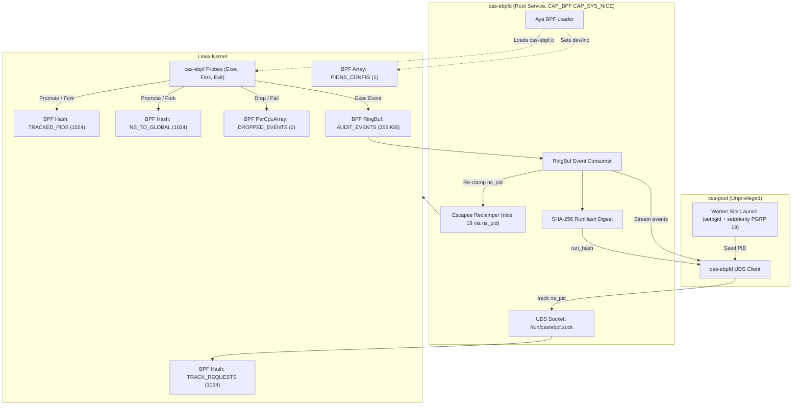

# 0014-ebpf-priority-clamping-and-audit-probes

## Overview

Host `ceres` executes many concurrent agent tasks. Heavy compiler and test
workloads must not starve interactive developer shells or Cortex mesh daemons.
Spec 0001 invariant 4.2 requires host build throttling. The Failure Matrix
specifies clamping build process trees to `nice 19`.

This spec defines eBPF tracepoint instrumentation and priority clamping in `cas-ebpf`:
- **CER-2719**: Worker process priority clamping via process groups (`PRIO_PGRP`)
  and eBPF anti-escape monitoring (`sched_process_exec`, `sched_process_fork`).
- **CER-2720**: Kernel execution audit ring buffer (`ExecEvent` on
  `sched_process_exec` and `sched_process_exit`) and SHA-256 `run_hash`
  transcript digest logger. Per operator ruling, `openat` and `connect`
  are excluded from Phase 2.
- **Privileged Daemon Architecture**: A root systemd service (`cas-ebpfd`)
  loads BPF programs, owns maps, and serves unprivileged `cas-pool` clients
  over a Unix Domain Socket (UDS).

Parent tickets: CER-2682, CER-2683.

Facts, measured 2026-10-09 on ceres (kernel `6.6.87.2-microsoft-standard-WSL2`):
- **T1: Toolchain Installation [verified]:** `bpf-linker 0.11.1` installed via mise (musl binary, SLSA sha256 `c974140662f783c37bf0267436409caa8f4708ec10b558d9d1c594385489fe2f`). Standard `cargo install` fails without system LLVM 23.
- **T2: Toolchain Inventory [verified]:** `rustup toolchain list` contains stable, nightly, and 1.94.1.
- **T3: Nightly rust-src Component [verified]:** Installed via `rustup component add rust-src --toolchain nightly` (`1.101.0-nightly (ea137335b 2026-10-05)`).
- **T4: Bytecode Compilation [verified]:** `crates/cas-ebpf/ebpf` builds under nightly with `-Z build-std=core` into a 7,864 byte ELF (`cas-ebpf.o`). Sections: `tracepoint`, `license`, `maps`. No `.BTF` section needed.
- **T5: Subcrate Manifests [verified]:** Subcrate contains independent `Cargo.toml`, `rust-toolchain.toml`, and `.cargo/config.toml` targeting `bpfel-unknown-none`.
- **T6: Autogroup Configuration [verified]:** `CONFIG_SCHED_AUTOGROUP` is NOT set on WSL2 (`/proc/self/autogroup` ENOENT).
- **T7: Tracepoint Layouts [verified]:** Formats on ceres: `sched_process_exec` (`filename` at 8, `pid` at 12); `sched_process_fork` (`parent_comm` at 8, `parent_pid` at 24, `child_comm` at 28, `child_pid` at 44; parent tgid from `bpf_get_current_pid_tgid() >> 32`); `sched_process_exit` (`comm` at 8, `pid` at 24, `prio` at 28). Main thread pid equals tgid.
- **T8: Priority Clamping Behavior on Linux [verified]:** `setpriority(PRIO_PROCESS, tgid, 19)` sets only the main thread ({main: 19, t1..3: 0}). `setpriority(PRIO_PGRP, pgid, 19)` sets all current and future threads to nice 19. Asserted by `crates/cas-ebpf/tests/clamp.rs`.
- **T9: Kernel Capability Requirements [verified]:** BPF loading requires `CAP_BPF`, `CAP_PERFMON`, and `CAP_SYS_NICE`. `kernel.unprivileged_bpf_disabled` is 2.
- **T10: Clean-Room Boundary [verified]:** Clean-room implementation using Aya (`aya 0.14.0`, `aya-ebpf 0.2.1`). Zero code from `neutral-engineering/autonice`.
- **T11: Dual Licensing Position [verified]:** Kernel BPF program declares `Dual MIT/GPL` in `license`. Userspace loader and crate remain proprietary.
- **T12: CI Capability Invariant [verified]:** Unprivileged `ci-rust` embeds committed `cas-ebpf.o`. Live integration tests run via `make ebpf-test` under sudo on ceres.
- **T13: Pid namespaces [verified 2026-10-10, lane w25:p1]:** Host `ceres` runs under a pid namespace (pid 1 is systemd; `/proc/self/ns/pid` inode 4026532221). The sched tracepoint fields and `bpf_get_current_pid_tgid` carry global pids. A `bpf_printk` build showed kernel tgid 2107147 for a process reporting userspace pid 1935786. Therefore, map lookups keyed by userspace pid failed (4 of 8 live gate failures). With the namespace translation architecture, the live gate passes 8 of 8 (`make ebpf-test`, sudo, 2026-10-10). The ELF bytecode size is 7,864 bytes with sha256 `8bdc59b358377b336c6776e10899b69542ad37374ce2e4481e48384d2743e95b`.

## Design

### Requirements (EARS)

- **Ubiquitous:** The `cas-ebpf` crate shall implement clean-room eBPF probes using Aya without copyleft dependencies.
- **Ubiquitous:** The root daemon `cas-ebpfd` shall hold `CAP_BPF`, `CAP_PERFMON` and `CAP_SYS_NICE` while serving unprivileged clients over a UDS socket, and shall accept `track` only for a pid owned by the peer's uid.
- **Ubiquitous:** The `cas-ebpf` loader shall configure `PIDNS_CONFIG` with the device and inode of `/proc/self/ns/pid` upon loading the eBPF object.
- **Event-driven:** WHEN a worker slot spawns, `cas-pool` shall configure a dedicated process group and clamp priority to `nice 19`.
- **Event-driven:** WHEN userspace calls `track(pid, ppid)`, `cas-ebpf` shall record the namespace pid and parent pid in `TRACK_REQUESTS`.
- **Event-driven:** WHEN a tracked process executes `exec` or `fork`, the probe shall translate `current` via `bpf_get_ns_current_pid_tgid`, promote matching `TRACK_REQUESTS` into `TRACKED_PIDS`, and insert the translation into `NS_TO_GLOBAL`.
- **Event-driven:** WHEN a tracked process forks, the probe shall insert the child global pid into `TRACKED_PIDS` with the parent namespace tgid.
- **Event-driven:** WHEN process exec or exit events fire, the eBPF probe shall stream structured `ExecEvent` records and update `run_hash`.
- **Event-driven:** WHEN submitting an `ExecEvent`, the probe shall populate `ns_pid` with the namespace tgid and `pid` with the global tgid.
- **Event-driven:** WHEN a tracked task exits, the probe shall evict its global pid from `TRACKED_PIDS`, its namespace pid from `NS_TO_GLOBAL`, and if group leader, evict from `TRACK_REQUESTS`.
- **State-driven:** WHILE tracking worker processes, `cas-ebpfd` shall read the nice value of every tracked pid that execs and re-clamp it to `nice 19` using `ns_pid`.
- **State-driven:** WHILE `PIDNS_CONFIG` contains zeroes (`[0, 0]`), the probes shall use global pids directly without namespace translation.
- **Unwanted behavior:** IF `TRACKED_PIDS` is full during promotion or fork insertion, THEN the probe shall increment `DROPPED_EVENTS[1]` (`tracking_failures`) and leave the process untracked.
- **Unwanted behavior:** IF the ring buffer is full when an exec event occurs, THEN the probe shall increment `DROPPED_EVENTS[0]` (`dropped_events`).

### Decisions

| # | Decision | Who, when |
|---|---|---|
| D1 | Clean-room Aya implementation: Build probe loader with `aya` 0.14.0 (MIT OR Apache-2.0). Never import or vendor `neutral-engineering/autonice` (GPL-2.0). | Spec 0004 & the operator, 2026-10-09 |
| D2 | Licensing boundary: The kernel-side BPF program declares `Dual MIT/GPL` in its license section to permit GPL-only BPF helpers. Crate `cas-ebpf` remains proprietary. Subcrate uses `MIT OR Apache-2.0`. | the operator, 2026-10-09 |
| D3 | Compile and packaging boundary: Kernel BPF bytecode crate lives at `crates/cas-ebpf/ebpf` outside monorepo workspace. Pre-compiled object `cas-ebpf.o` is committed next to `cas-ebpf.o.sha256`; `make ebpf-build` rebuilds both (reproducible: two builds on ceres gave the same hash, 2026-10-09). `build.rs` never rebuilds; it refuses to compile the crate when the object and the recorded hash disagree. The crate embeds `cas-ebpf.o` via `include_bytes!`. Workspace builds on stable Rust. Object sha256 `8bdc59b358377b336c6776e10899b69542ad37374ce2e4481e48384d2743e95b` (7,864 bytes). | CAS lanes, 2026-10-09 |
| D4 | Priority clamping mechanism (R2): `cas-pool` creates a dedicated process group (`setpgid(0, 0)`) for each worker slot and calls `setpriority(PRIO_PGRP, pgid, 19)` once before exec. All threads and child processes inherit nice 19 without privileges or race conditions. | the operator ruling, 2026-10-09 |
| D5 | Narrowed scope & anti-escape monitoring (R1): No host-wide autonice. Clamping applies exclusively to worker process trees registered in `TRACKED_PIDS` by `cas-pool`. The eBPF probe detects if a child process leaves its group (`setsid` or `setpgid`) and triggers re-clamping. Target compiler basenames serve as optional audit tags. | the operator ruling, 2026-10-09 |
| D6 | Execution audit ring buffer (R4): CER-2720 narrowed to exec and exit events. BPF ring buffer (`AUDIT_EVENTS`, 256 KiB) streams structured 168-byte `ExecEvent` records. Openat and connect are out of Phase 2. | the operator ruling, 2026-10-09 |
| D7 | SHA-256 `run_hash` execution transcript digest (D-E): Incremental SHA-256 digest over 168-byte `#[repr(C)]` little-endian records in ring-buffer delivery order. Serves as execution transcript proof in Saga receipts. Dropped-event counter tracks ring-buffer overflows. | the operator ruling, 2026-10-09 |
| D8 | Privileged daemon architecture (`cas-ebpfd`, R3): A dedicated root systemd unit `cas-ebpfd` runs with `CAP_BPF`, `CAP_PERFMON`, and `CAP_SYS_NICE`. It owns maps and ring buffers, serving unprivileged `cas-pool` over a UDS with strict allowlist (`track`, `untrack`, `stream_events`). `cas-pool` remains unprivileged. | the operator ruling, 2026-10-09 |
| D9 | Map lifecycle & eviction (D-F): Loader API provides `track(pid)` and `untrack(pid)`. `sched_process_exit` probe automatically evicts exited PIDs from `TRACKED_PIDS` (1024 entries), preventing map leaks. | CAS lanes, 2026-10-09 |
| D10 | Dependency pins & error handling: Pinned: `aya = "0.14.0"`, `aya-ebpf = "0.2.1"`, `sha2 = "0.11.0"`, `rustix = "1.1.5"`. Uses `thiserror` for typed `EbpfError`. | Spec 0004 & CAS lanes, 2026-10-09 |
| D11 | PID namespace translation and promotion architecture: The daemon resolves `/proc/self/ns/pid` dev/ino into `PIDNS_CONFIG`. Probes translate via `bpf_get_ns_current_pid_tgid`. Userspace track requests are queued in `TRACK_REQUESTS` and promoted to `TRACKED_PIDS` on first fork or exec, populating `NS_TO_GLOBAL`. `ExecEvent` carries `ns_pid` at offset 164 for userspace re-clamping. | the operator ruling & CAS lanes, 2026-10-10 |

### Architecture and Flow



### Tracepoint Probes & Maps

1. **`sched_process_fork` Probe:** Intercepts process clone and fork events. Reads `child_pid` (offset 44) from tracepoint record. Checks whether parent is tracked via `promote(&ids)`. If parent is tracked, inserts `(child_pid, parent_nstgid)` into `TRACKED_PIDS`. If `TRACKED_PIDS` is full, increments `DROPPED_EVENTS[1]` (`tracking_failures`), signifying an escaped child process.
2. **`sched_process_exec` Probe:** Intercepts `execve` events. Translates `current` via `current_ids()`. Invokes `promote(&ids)` to promote any pending `TRACK_REQUESTS`. If tracked, populates `NS_TO_GLOBAL`, reads process metadata (`comm`, `uid`, `filename`, timestamp), and writes a 168-byte `ExecEvent` to `AUDIT_EVENTS` (256 KiB ring buffer). Reservation failure increments `DROPPED_EVENTS[0]` (`dropped_events`).
3. **`sched_process_exit` Probe:** Intercepts process termination. Removes exiting global `gpid` from `TRACKED_PIDS`. Resolves namespace IDs and removes `nspid` from `NS_TO_GLOBAL`. When a thread group leader exits (`gpid == gtgid`), removes `nstgid` from `TRACK_REQUESTS`.
4. **Counters (`DROPPED_EVENTS`):** A two-slot `PerCpuArray<u64>`:
   - Slot 0: Ring-buffer reserve failures (`ProbeHandle::dropped_events`, emitted on `{"dropped":N}` lines).
   - Slot 1: Fork inserts and track promotions refused because `TRACKED_PIDS` was full (`Probes::tracking_failures`); a non-zero count indicates a child worker escaped tracking.

### Pid Namespaces and Map Architecture

When running under container engines or systemd scopes on host `ceres`, userspace processes reside in a distinct PID namespace (`/proc/self/ns/pid`). Kernel tracepoint arguments and helper `bpf_get_current_pid_tgid()` return global kernel PIDs. Therefore, userspace PIDs cannot directly match kernel tracepoint PIDs without translation.

The eBPF subsystem manages translation through five dedicated BPF maps:

| Map Name | Map Type | Key | Value | Max Entries | Ownership & Purpose |
|---|---|---|---|---|---|
| `PIDNS_CONFIG` | `Array<[u64; 2]>` | `u32` (index 0) | `[u64; 2]` (`[dev, ino]`) | 1 | Daemon writes at load; kernel reads via `bpf_get_ns_current_pid_tgid`. `[0, 0]` disables translation. |
| `TRACK_REQUESTS` | `HashMap<u32, u32>` | `u32` (`ns_tgid`) | `u32` (`ns_ppid`) | 1024 | Userspace writes via `track(pid, ppid)`; stores pending track requests in namespace coordinates. |
| `TRACKED_PIDS` | `HashMap<u32, u32>` | `u32` (`global_tgid`/`child_pid`) | `u32` (`ns_ppid`) | 1024 | Kernel writes upon promotion or child fork; keys tracking by global task ID. |
| `NS_TO_GLOBAL` | `HashMap<u32, u32>` | `u32` (`ns_pid`) | `u32` (`global_pid`) | 1024 | Kernel writes upon promotion or exec; maps namespace pid to global task ID for `untrack` and `is_tracked`. |
| `AUDIT_EVENTS` | `RingBuf` | N/A | `ExecEvent` (168 bytes) | 256 KiB | Kernel writes on tracked exec; userspace drainer consumes in order. |
| `DROPPED_EVENTS` | `PerCpuArray<u64>` | `u32` (slot 0 or 1) | `u64` (counter) | 2 | Per-CPU drop counters. Slot 0: ring buffer drops; Slot 1: tracking insert/promotion refusals. |

#### The Promotion Rule

Because userspace cannot determine the kernel's global PID for a newly spawned process, registration occurs in two phases:

1. **Request Phase:** Userspace calls `track(ns_pid, ns_ppid)`. The daemon inserts `ns_pid -> ns_ppid` into `TRACK_REQUESTS`.
2. **Promotion Phase:** At the process's first post-registration `exec` or `fork`, the kernel probe fires:
   - The probe calls `bpf_get_current_pid_tgid()` to obtain global `(gpid, gtgid)`.
   - The probe calls `bpf_get_ns_current_pid_tgid()` with the configured `(dev, ino)` to obtain `(nspid, nstgid)`.
   - If `gtgid` already exists in `TRACKED_PIDS`, the process is already promoted.
   - If `gtgid` is absent, the probe queries `TRACK_REQUESTS` for `nstgid`.
   - When matched, the probe promotes the process by inserting `(gtgid, ns_ppid)` into `TRACKED_PIDS` and `(nstgid, gtgid)` into `NS_TO_GLOBAL`.
   - If `TRACKED_PIDS` is full, the probe increments `DROPPED_EVENTS[1]` (`tracking_failures`) and aborts tracking.
3. **Fork Inheritance Phase:** When a tracked process forks, `sched_process_fork` intercepts the event. The parent's global PID is tracked, and the probe inserts `(child_pid, parent_nstgid)` directly into `TRACKED_PIDS`.
4. **Eviction Phase:** When a process exits, `sched_process_exit` removes `gpid` from `TRACKED_PIDS` and `nspid` from `NS_TO_GLOBAL`. When the thread group leader exits (`gpid == gtgid`), it also removes `nstgid` from `TRACK_REQUESTS`.

#### `ExecEvent` Memory Layout (168 bytes)

`ExecEvent` uses `#[repr(C)]` layout with 8-byte alignment:

| Field | Type | Offset | Size | Description |
|---|---|---|---|---|
| `timestamp_ns` | `u64` | 0 | 8 | Monotonic timestamp from `bpf_ktime_get_ns()`. |
| `pid` | `u32` | 8 | 4 | Global kernel thread group ID (`gtgid`). |
| `ppid` | `u32` | 12 | 4 | Parent thread group ID in the daemon's PID namespace. |
| `uid` | `u32` | 16 | 4 | User ID from `bpf_get_current_uid_gid()`. |
| `comm` | `[u8; 16]` | 20 | 16 | Process command name from `bpf_get_current_comm()`. |
| `filename` | `[u8; 128]` | 36 | 128 | Executed file path read from tracepoint context. |
| `ns_pid` | `u32` | 164 | 4 | Process thread group ID in the daemon's PID namespace (`nstgid`). |

The daemon uses `ns_pid` to re-clamp priority via `setpriority(PRIO_PROCESS, ns_pid, 19)`. Because the daemon shares the PID namespace with workers, `ns_pid` resolves directly without privilege leaks or cross-namespace ambiguity.

### Priority Clamping Invariants

- **Process Group Clamping:** `cas-pool` sets worker process group (`setpgid(0, 0)`) and invokes `setpriority(PRIO_PGRP, pgid, 19)` before `execve`.
- **Thread Inheritance:** All threads created by rustc and cargo inherit nice 19 from process group launch.
- **Anti-Escape Defense:** `setsid()` and `setpgid()` do not change a nice value. `cas-ebpfd` inspects tracked PIDs on exec and re-clamps any process whose nice is below 19 using `setpriority(PRIO_PROCESS, ns_pid, 19)`. It skips processes whose effective UID differs from real UID (setuid binaries).
- **System Call Safety:** Userspace invocations use `rustix` (`clamp.rs`) without `unsafe`. The single unsafe site is `CommandExt::pre_exec` in `cas-pool` and tests, annotated with `#[allow(unsafe_code)]` and `// SAFETY:`.

### Audit Hash (`run_hash`) Specification

1. `run_hash` is a per-run execution transcript digest for Saga receipts.
2. Events are serialized in strict monotonic ring buffer delivery order.
3. Each 168-byte `ExecEvent` record is hashed sequentially with `sha2` (0.11.0).
4. On session completion, the hasher finalizes to a hex-encoded `run_hash`.
5. Non-zero dropped event count (`dropped_events`) invalidates deterministic execution claims.

### Deployment: `cas-ebpfd` Daemon

- **Systemd Unit File:** `/etc/systemd/system/cas-ebpfd.service`:
  ```ini
  [Unit]
  Description=Cerebral Agent Substrate eBPF Clamping and Audit Daemon
  After=network.target

  [Service]
  Type=simple
  ExecStart=/usr/local/bin/cas-ebpfd --socket /run/cas/ebpf.sock --socket-group ctodie
  Restart=on-failure
  User=root
  Group=root
  RuntimeDirectory=cas
  RuntimeDirectoryMode=0755
  AmbientCapabilities=CAP_BPF CAP_PERFMON CAP_SYS_NICE
  CapabilityBoundingSet=CAP_BPF CAP_PERFMON CAP_SYS_NICE
  ProtectSystem=strict
  ProtectHome=read-only

  [Install]
  WantedBy=multi-user.target
  ```
- **Socket & Permissions:** Bound under umask `0117`, mode `0660`, owned by `--socket-group` (default `ctodie`).
- **Peer Rules (SO_PEERCRED):** The daemon reads `SO_PEERCRED` on every connection and rejects connections without credentials. `track` is capped per non-root UID at 256 PIDs (`daemon::DEFAULT_TRACK_QUOTA`, `Daemon::with_track_quota`). Requests exceeding quota return `{"ok":false,"error":"track quota 256 reached for uid U"}`. Reason: `TRACKED_PIDS` (1024 entries) is shared across all clients and thread clones spend entries while running. Target process UID must equal peer UID (`/proc/<pid>/status`). `untrack` requires peer ownership. `stream` delivers only the peer's UID events. Root peers are exempt from all quotas and restrictions.
- **UDS Protocol:** JSON lines, max 4096 bytes per line:
  - `{"op":"track","pid":N,"ppid":P}` -> `{"ok":true}`
  - `{"op":"untrack","pid":N}` -> `{"ok":true}`
  - `{"op":"status"}` -> `{"ok":true,"tracked":K,"dropped_events":D}`
  - `{"op":"stream"}` -> `{"ok":true}`, followed by `{"event":{...}}`, `{"dropped":N}`, and `{"lagged":N}` lines.
- **Unprivileged Fallback:** When `/run/cas/ebpf.sock` is absent, `cas-pool` falls back to `PRIO_PGRP` clamping and marks audit status `unattested`.

### Failure Modes & Errors

```rust
#[derive(Debug, thiserror::Error)]
pub enum EbpfError {
    #[error("kernel lacks BTF debug info")]
    BtfMissing,
    #[error("missing required capabilities (CAP_BPF, CAP_PERFMON, CAP_SYS_NICE)")]
    PermissionDenied,
    #[error("failed to attach to tracepoint {name}: {source}")]
    AttachTracepointFailed { name: &'static str, #[source] source: aya::ProgramError },
    #[error("audit ring buffer dropped {dropped} events")]
    RingBufferOverflow { dropped: u64 },
    #[error("failed to connect to cas-ebpfd socket at {path}: {source}")]
    DaemonUnavailable { path: String, #[source] source: std::io::Error },
}
```

## Plan

- [x] Create standalone eBPF subcrate `crates/cas-ebpf/ebpf/`.
- [x] Configure nightly toolchain and `bpf-linker` via mise.
- [x] Implement kernel tracepoint probes (`sched_process_exec`, `sched_process_fork`, `sched_process_exit`).
- [x] Compile and verify relocatable ELF object (`cas-ebpf.o`, 7,864 bytes, Dual MIT/GPL, reproducible hash).
- [x] Add `cas-ebpf.o` artifact, SHA-256 hash file, and `make ebpf-build` recipe.
- [x] Implement `build.rs` in `cas-ebpf` that refuses to build when the object and the hash file disagree.
- [x] Implement userspace BPF loader and map bindings in `cas-ebpf` (`loader::Probes`).
- [x] Implement `cas-ebpfd` daemon with Unix domain socket listener, line protocol and blocking client.
- [x] Implement `run_hash` transcript digest generator with `sha2 = "0.11.0"` (`audit::RunHash`).
- [x] Add `make ebpf-test` target: builds the live test binary unprivileged, runs it under sudo.
- [x] Unprivileged tests (59 in CI): wire layout, run_hash determinism, drop invalidation, enter_clamped_group nice 19, daemon handle mocking.
- [x] Live gate on ceres (`make ebpf-test`, sudo, 2026-10-10): attach, event capture with `ns_pid`, fork propagation, exit eviction, counters pass 8 of 8.
- [ ] Wire `cas-pool` (spec 0015): `enter_clamped_group` in `pre_exec`, `DaemonClient::track` after spawn, `AuditReceipt` into Saga receipt, `unattested` fallback.
- [ ] Install the unit on ceres (`crates/cas-ebpf/cas-ebpfd.service`), operator-run.
- [x] Update `specs/README.md` (status in-progress).

## Test

```bash
# Unit tests in workspace (unprivileged, probe-and-skip)
cargo test -p cas-ebpf -j 2 --lib

# Real eBPF probe integration tests (requires sudo on ceres)
make ebpf-test JOBS=2
```

## Notes

- **Aya Licence:** `aya` and `aya-ebpf` are licensed `MIT OR Apache-2.0`.
- **GPL Helper Compatibility:** Declaring `Dual MIT/GPL` in the ELF license section permits calling GPL-only kernel helpers without licensing contamination of userspace crates.
- **Clean-Room Boundary:** Zero code is copied from `neutral-engineering/autonice`.
- **Committed Object Invariant:** `crates/cas-ebpf/ebpf/cas-ebpf.o` is committed in git. Unprivileged CI containers (`ci-rust`) build `cas-ebpf` without nightly or `bpf-linker` by embedding the pre-compiled artifact via `include_bytes!`.
