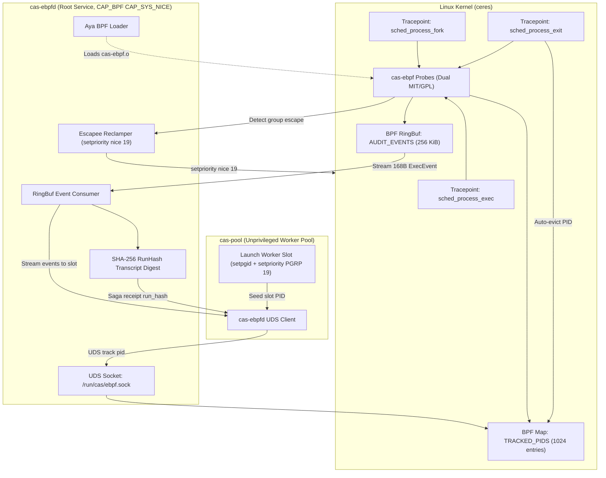

# 0014-ebpf-priority-clamping-and-audit-probes

## Overview

Host `ceres` executes many concurrent agent tasks. Heavy compiler and test
workloads must not starve interactive developer shells or Cortex mesh daemons.
Spec 0001 invariant 4.2 requires host build throttling. The Failure Matrix
specifies clamping build process trees to `nice 19`.

This spec defines eBPF tracepoint instrumentation and priority clamping in `cas-ebpf`:
- **CER-2719**: Worker process priority clamping via process groups (`PRIO_PGRP`)
  and eBPF anti-escape monitoring (`sched_process_exec`, `sched_process_fork`).
- **CER-2720**: Kernel execution audit ring buffer (`ExecEvent` on
  `sched_process_exec` and `sched_process_exit`) and SHA-256 `run_hash`
  transcript digest logger. Per operator ruling, `openat` and `connect`
  are excluded from Phase 2.
- **Privileged Daemon Architecture**: A root systemd service (`cas-ebpfd`)
  loads BPF programs, owns maps, and serves unprivileged `cas-pool` clients
  over a Unix Domain Socket (UDS).

Parent tickets: CER-2682, CER-2683.

Facts, measured 2026-10-09 on ceres (kernel `6.6.87.2-microsoft-standard-WSL2`):

- **T1: Toolchain Installation [verified]:** `bpf-linker 0.11.1` is installed via
  `mise use -g github:aya-rs/bpf-linker@v0.11.1` (musl prebuilt binary with SLSA
  provenance, binary sha256 `c974140662f783c37bf0267436409caa8f4708ec10b558d9d1c594385489fe2f`).
  Standard `cargo install bpf-linker` fails on ceres because system LLVM 23 and
  `llvm-config` are absent.
- **T2: Toolchain Inventory [verified]:** `rustup toolchain list` contains `stable`
  (default), `nightly`, and `1.94.1` (pinned monorepo toolchain).
- **T3: Nightly rust-src Component [verified]:** Nightly `rust-src` was installed via
  `rustup component add rust-src --toolchain nightly`. Nightly version is
  `1.101.0-nightly (ea137335b 2026-10-05)`.
- **T4: Bytecode Compilation [verified]:** Subcrate `crates/cas-ebpf/ebpf` compiles
  cleanly under nightly targeting `bpfel-unknown-none` with `-Z build-std=core` into
  a 1.4 KB relocatable ELF (`cas-ebpf.o`). Sections: `tracepoint`, `license`, `maps`.
  No `.BTF` section is required for tracepoints.
- **T5: Subcrate Manifests [verified]:** Subcrate contains `rust-toolchain.toml` (nightly),
  `.cargo/config.toml` (target `bpfel-unknown-none`, linker `bpf-linker`), and an
  independent `[workspace]` root in `Cargo.toml`.
- **T6: Autogroup Configuration [verified]:** `CONFIG_SCHED_AUTOGROUP` is NOT set on
  the WSL2 kernel (`/proc/self/autogroup` ENOENT). Autogroup nice cannot be used.
- **T7: Tracepoint Layouts [verified]:**
  - `/sys/kernel/tracing/events/sched/sched_process_exec/format`: `filename` is
    `__data_loc char[]` at offset 8 (size 4), `pid` at 12, `old_pid` at 16. Reading
    `filename`: low 16 bits = offset, high 16 bits = length; read via
    `bpf_probe_read_kernel_str_bytes`. At exec tracepoint, `comm` already contains
    the new basename (15 chars + null); `bpf_get_current_comm` matches without
    in-kernel path parsing.
  - `/sys/kernel/tracing/events/sched/sched_process_fork/format`: `parent_pid` at
    offset 16, `child_pid` at offset 20.
  - `/sys/kernel/tracing/events/sched/sched_process_exit/format`: `pid` at offset 12,
    `prio` at offset 16.
- **T8: Priority Clamping Behavior on Linux [verified]:** `setpriority(PRIO_PROCESS, tgid, 19)`
  modifies only the calling or targeted main thread. A 4-thread process after
  `renice -n 19 -p` yielded `{main: 19, t1: 0, t2: 0, t3: 0}` because worker pools
  (rustc and cargo) spawn threads immediately. In contrast, `setpriority(PRIO_PGRP, pgid, 19)`
  sets the entire process group and all future child threads to nice 19.
- **T9: Kernel Capability Requirements [verified]:** Tracefs and BPF loading require
  `CAP_BPF`, `CAP_PERFMON`, and `CAP_SYS_NICE`. `kernel.unprivileged_bpf_disabled` is `2`.
- **T10: Clean-Room Boundary [verified]:** Clean-room implementation using Aya (`aya 0.14.0`,
  `aya-ebpf 0.2.1`). Zero code is copied from `neutral-engineering/autonice` (GPL-2.0).
- **T11: Dual Licensing Position [verified]:** Decided by the operator on 2026-10-09: the
  kernel-side BPF program object declares `Dual MIT/GPL` in its `license` section.
  The userspace loader and crate remain proprietary.
- **T12: CI Capability Invariant [verified]:** Unprivileged `ci-rust` container lacks BPF
  capabilities and nightly toolchains. Pre-compiled object `cas-ebpf.o` is committed
  and embedded. Integration tests run via `make ebpf-test` under sudo on ceres.

## Design

### Decisions

| # | Decision | Who, when |
|---|---|---|
| D1 | Clean-room Aya implementation: Build probe loader with `aya` 0.14.0 (MIT OR Apache-2.0). Never import or vendor `neutral-engineering/autonice` (GPL-2.0). | Spec 0004 & the operator, 2026-10-09 |
| D2 | Licensing boundary: The kernel-side BPF program declares `Dual MIT/GPL` in its license section to permit GPL-only BPF helpers. Crate `cas-ebpf` remains proprietary. Subcrate uses `MIT OR Apache-2.0`. | the operator, 2026-10-09 |
| D3 | Compile and packaging boundary: Kernel BPF bytecode crate lives at `crates/cas-ebpf/ebpf` outside monorepo workspace. Pre-compiled object `cas-ebpf.o` is committed with SHA-256 and build command. `build.rs` rebuilds when nightly and `bpf-linker` exist; embeds `cas-ebpf.o` via `include_bytes!`. Workspace builds on stable Rust. | CAS lanes, 2026-10-09 |
| D4 | Priority clamping mechanism (R2): `cas-pool` creates a dedicated process group (`setpgid(0, 0)`) for each worker slot and calls `setpriority(PRIO_PGRP, pgid, 19)` once before exec. All threads and child processes inherit nice 19 without privileges or race conditions. | the operator ruling, 2026-10-09 |
| D5 | Narrowed scope & anti-escape monitoring (R1): No host-wide autonice. Clamping applies exclusively to worker process trees registered in `TRACKED_PIDS` by `cas-pool`. The eBPF probe detects if a child process leaves its group (`setsid` or `setpgid`) and triggers re-clamping. Target compiler basenames serve as optional audit tags. | the operator ruling, 2026-10-09 |
| D6 | Execution audit ring buffer (R4): CER-2720 narrowed to exec and exit events. BPF ring buffer (`AUDIT_EVENTS`, 256 KiB) streams structured 168-byte `ExecEvent` records. Openat and connect are out of Phase 2. | the operator ruling, 2026-10-09 |
| D7 | SHA-256 `run_hash` execution transcript digest (D-E): Incremental SHA-256 digest over 168-byte `#[repr(C)]` little-endian records in ring-buffer delivery order. Serves as execution transcript proof in Saga receipts. Dropped-event counter tracks ring-buffer overflows. | the operator ruling, 2026-10-09 |
| D8 | Privileged daemon architecture (`cas-ebpfd`, R3): A dedicated root systemd unit `cas-ebpfd` runs with `CAP_BPF`, `CAP_PERFMON`, and `CAP_SYS_NICE`. It owns maps and ring buffers, serving unprivileged `cas-pool` over a UDS with strict allowlist (`track`, `untrack`, `stream_events`). `cas-pool` remains unprivileged. | the operator ruling, 2026-10-09 |
| D9 | Map lifecycle & eviction (D-F): Loader API provides `track(pid)` and `untrack(pid)`. `sched_process_exit` probe automatically evicts exited PIDs from `TRACKED_PIDS` (1024 entries), preventing map leaks. | CAS lanes, 2026-10-09 |
| D10 | Dependency pins & error handling: Pinned: `aya = "0.14.0"`, `aya-ebpf = "0.2.1"`, `sha2 = "0.11.0"`, `libc = "0.2.169"`. Uses `thiserror` for typed `EbpfError`. | Spec 0004 & CAS lanes, 2026-10-09 |

### Architecture and Flow



### Tracepoint Probes & Maps

1. **`sched_process_fork` Probe:**
   - Reads `parent_pid` (offset 16) and `child_pid` (offset 20).
   - If `parent_pid` exists in `TRACKED_PIDS`, inserts `child_pid` into `TRACKED_PIDS`.
   - Propagates tracking to all child worker processes automatically.

2. **`sched_process_exec` Probe:**
   - Reads `pid` (offset 12) and `filename` from `__data_loc char[]` (offset 8).
   - If `pid` exists in `TRACKED_PIDS`:
     - Reads command basename via `bpf_get_current_comm`.
     - Populates `ExecEvent` struct and submits to `AUDIT_EVENTS` ring buffer.
     - Checks process group ID; if process escaped group, notifies daemon to re-clamp.

3. **`sched_process_exit` Probe:**
   - Reads `pid` (offset 12).
   - If `pid` exists in `TRACKED_PIDS`, deletes `pid` from `TRACKED_PIDS`.
   - Prevents stale entries from exhausting the 1024-entry hash map.

4. **`ExecEvent` Memory Layout (168 bytes):**
   - `timestamp_ns: u64` (8 bytes, offset 0): Monotonic kernel timestamp.
   - `pid: u32` (4 bytes, offset 8): Process ID.
   - `ppid: u32` (4 bytes, offset 12): Parent Process ID.
   - `uid: u32` (4 bytes, offset 16): User ID.
   - `comm: [u8; 16]` (16 bytes, offset 20): Process command name.
   - `filename: [u8; 128]` (128 bytes, offset 36): Executed binary path.
   - `_pad: u32` (4 bytes, offset 164): Explicit padding to 8-byte boundary.

### Priority Clamping Invariants

- **Process Group Clamping:** `cas-pool` sets worker process group (`setpgid(0, 0)`)
  and invokes `setpriority(PRIO_PGRP, pgid, 19)` before `execve`.
- **Thread Inheritance:** All threads created by rustc and cargo inherit nice 19
  from process group launch.
- **Anti-Escape Defense:** If an adversarial or misconfigured process executes
  `setsid()` or `setpgid()` to escape its process group, `cas-ebpfd` re-clamps
  the process using `setpriority(PRIO_PROCESS, pid, 19)`.
- **System Call Safety:** Any raw syscall is annotated with `#[allow(unsafe_code)]`
  and a descriptive `// SAFETY:` comment per AGENTS.md rule 14.

### Audit Hash (`run_hash`) Specification

The audit digest records exact execution sequence for Saga receipts:
1. `run_hash` is a per-run execution transcript digest, not a static content hash.
2. Events are serialized in strict monotonic ring buffer delivery order.
3. For each `ExecEvent`, serialize the 168-byte `#[repr(C)]` record in little-endian format.
4. Incremental SHA-256 hasher (`sha2` 0.11.0) digests each record sequentially.
5. On slot session completion, the hasher finalizes to hex string `run_hash`.
6. Dropped event counter (`dropped_events`) is included in the execution receipt.
   Any non-zero drop count invalidates deterministic execution claims.

### Deployment: `cas-ebpfd` Daemon

- **Systemd Unit File:** `/etc/systemd/system/cas-ebpfd.service`:
  ```ini
  [Unit]
  Description=Cerebral Agent Substrate eBPF Clamping and Audit Daemon
  After=network.target

  [Service]
  Type=simple
  ExecStart=/usr/local/bin/cas-ebpfd --socket /run/cas/ebpf.sock
  Restart=on-failure
  User=root
  Group=root
  RuntimeDirectory=cas
  RuntimeDirectoryMode=0755
  AmbientCapabilities=CAP_BPF CAP_PERFMON CAP_SYS_NICE
  CapabilityBoundingSet=CAP_BPF CAP_PERFMON CAP_SYS_NICE
  ProtectSystem=strict
  ProtectHome=read-only

  [Install]
  WantedBy=multi-user.target
  ```
- **Socket Permissions:** `/run/cas/ebpf.sock` created with mode `0660`, group `docker` or `ctodie`.
- **UDS Protocol:** Minimal length-delimited JSON-RPC or binary command frame:
  - `Track { pid: u32 }` -> `Ok`
  - `Untrack { pid: u32 }` -> `Ok`
  - `StreamEvents { slot_id: String }` -> Streaming `ExecEvent` frames
- **Unprivileged Fallback:** When `/run/cas/ebpf.sock` is absent, `cas-pool` falls back
  to `PRIO_PGRP` clamping alone and records audit status as `unattested`.

### Failure Modes & Errors

```rust
use thiserror::Error;

#[derive(Debug, Error)]
pub enum EbpfError {
    #[error("kernel lacks BTF debug info")]
    BtfMissing,
    #[error("missing required capabilities (CAP_BPF, CAP_PERFMON, CAP_SYS_NICE)")]
    PermissionDenied,
    #[error("failed to attach to tracepoint {name}: {source}")]
    AttachTracepointFailed {
        name: &'static str,
        #[source]
        source: aya::ProgramError,
    },
    #[error("audit ring buffer dropped {dropped} events")]
    RingBufferOverflow { dropped: u64 },
    #[error("failed to connect to cas-ebpfd socket at {path}: {source}")]
    DaemonUnavailable {
        path: String,
        #[source]
        source: std::io::Error,
    },
}
```

## Plan

- [x] Create standalone eBPF subcrate `crates/cas-ebpf/ebpf/`.
- [x] Configure nightly toolchain and `bpf-linker` via mise.
- [x] Implement kernel tracepoint probes (`sched_process_exec`, `sched_process_fork`, `sched_process_exit`).
- [x] Compile and verify relocatable ELF object (`cas-ebpf.o`, 1.4 KB, Dual MIT/GPL).
- [ ] Add `cas-ebpf.o` artifact, SHA-256 hash, and build recipe to Makefile.
- [ ] Implement `build.rs` in `cas-ebpf` verifying bytecode hash when toolchain exists.
- [ ] Implement userspace BPF loader and map bindings in `cas-ebpf`.
- [ ] Implement `cas-ebpfd` daemon with Unix domain socket listener.
- [ ] Implement `run_hash` transcript digest generator with `sha2 = "0.11.0"`.
- [ ] Add `make ebpf-test` target running integration tests under sudo.
- [ ] Unit tests with mocked event stream:
  - Process group clamping sets nice 19.
  - Child process fork inherits tracked state.
  - Exited process evicts from tracked map.
  - `run_hash` is deterministic for identical execution traces.
- [ ] Update `specs/README.md` and `cas-epics-phase-2-to-5-roadmap.md`.

## Test

```bash
# Unit tests in workspace (unprivileged, probe-and-skip)
cargo test -p cas-ebpf -j 2 --lib

# Real eBPF probe integration tests (requires sudo on ceres)
make ebpf-test JOBS=2
```

## Notes

- **Aya Licence:** `aya` and `aya-ebpf` are licensed `MIT OR Apache-2.0`.
- **GPL Helper Compatibility:** Declaring `Dual MIT/GPL` in the ELF license section
  permits calling GPL-only kernel helpers without licensing contamination of
  userspace crates.
- **Clean-Room Boundary:** Zero code is copied from `neutral-engineering/autonice`.
- **Committed Object Invariant:** `crates/cas-ebpf/ebpf/cas-ebpf.o` is committed
  in git. Unprivileged CI containers (`ci-rust`) build `cas-ebpf` without nightly
  or `bpf-linker` by embedding the pre-compiled artifact via `include_bytes!`.
