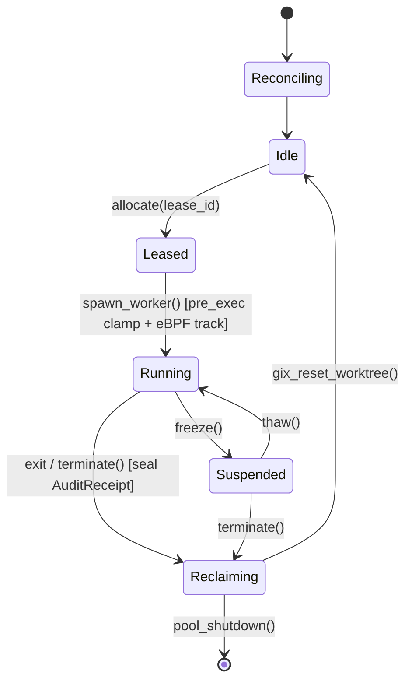

<!-- SPDX-License-Identifier: CC-BY-4.0 -->

# 0015-slot-pool-cgroup-freezer-and-gitoxide

## Overview

Host `ceres` executes many concurrent agent tasks. Spawning unbounded workers
or allocating physical Git worktrees on host disk causes disk exhaustion and
CPU starvation. Spec 0001 invariant 4.2 and Global Config mandate strict host
throttling (`-j 2`).

This spec defines the worker slot manager in `uas-pool` (Phase 3, CER-2682):
- **CER-2723**: Slot allocation, lease tracking, and concurrency limits.
- **CER-2724**: Warm worktree forks with in-process gitoxide (`gix`).
- **CER-2722**: Worker suspend and resume using the Linux cgroup v2 freezer.
- **eBPF Clamping & Audit Hooks**: Process priority clamping (`nice 19`) via
  `uas_ebpf::clamp::enter_clamped_group` and kernel execution audit via
  `uas_ebpf::client::DaemonClient` (spec 0014).

## Design

### Requirements (EARS)

- **Ubiquitous:** The `uas-pool` slot manager shall enforce host concurrency limits (`max_slots = 2`) on worker allocations.
- **Ubiquitous:** The pool shall manage ephemeral worktrees using in-process `gix` operations without external `git` subprocesses.
- **Event-driven:** WHEN freezing an inactive worker, the pool shall write `1` to `cgroup.freeze`.
- **Event-driven:** WHEN spawning a worker process, the pool shall call `uas_ebpf::clamp::enter_clamped_group` in `pre_exec` and register the child PID via `DaemonClient::track`.
- **State-driven:** WHILE a worker executes, the pool shall consume `EventStream` and incorporate `AuditReceipt` into the task's Saga execution receipt.
- **State-driven:** WHILE reclaiming an expired slot, the pool shall reap child processes and reset worktree state.
- **Unwanted behavior:** IF cgroup v2 operations fail, THEN the pool shall fallback to POSIX `SIGSTOP` and `SIGCONT` signals.
- **Unwanted behavior:** IF `uas-ebpfd` is unavailable, THEN the pool shall proceed with process group clamping and mark the audit receipt as `unattested`.

### Decisions

| # | Decision | Who, when |
|---|---|---|
| D1 | Slot concurrency limit: `uas-pool` enforces a strict capacity limit (`max_slots`, default 2 on host ceres). Requests exceeding capacity are rejected or placed in a bounded queue. | UAS lane, 2026-10-09 |
| D2 | Worktree isolation via `gix`: Worktrees share the base repository object store. `gix` creates ephemeral checkouts in `/workspace/slots/<slot-id>`. It resets dirty files on reclaim without invoking `git` CLI sub-processes. | UAS lane, 2026-10-09 |
| D3 | Process suspension and resource quota via cgroup v2: `uas-pool` creates `/sys/fs/cgroup/uas/slot-<id>`. It writes `1` to `cgroup.freeze` to suspend workers, and `0` to thaw them. It configures CPU quotas via `cpu.max` (defaulting to 2 CPUs: 200,000us / 100,000us per Spec 0020 D3). The cgroup also carries the memory, pids and swap limits of spec 0041. | Spec 0020 & UAS lane, 2026-10-09 |
| D4 | Graceful freezer fallback: If cgroup v2 is not writable, `uas-pool` falls back to POSIX `SIGSTOP` and `SIGCONT` signals sent to the worker process group. | UAS lane, 2026-10-09 |
| D5 | Runtime choice: `uas-pool` uses standard OS threads with `std::sync` primitives for slot management. Thread blocking operations handle synchronous `gix` disk operations and cgroup file I/O. | UAS lane, 2026-10-09; ruled in spec 0019 (D2, Option A, the operator, 2026-10-10 [reported, relayed by the integrator, mesh e42efbc2]) |
| D6 | eBPF clamping and audit integration: Slot worker spawn sets `enter_clamped_group` in `pre_exec` (sets process group and `nice 19`). Post-spawn registers PID via `DaemonClient::track(child_pid, own_pid)` over UDS. Execution streams `ExecEvent` records into `AuditReceipt` with `run_hash`. Daemon unavailability yields `unattested` audit receipt without failing worker execution. | Spec 0014 & UAS lane, 2026-10-09 |

### Architecture and Lifecycle



### Slot States and Operations

1. **`Idle`**: The slot has an initialized, clean worktree directory. No process runs.
2. **`Leased`**: A caller acquired a `SlotLease` governed by `uas-domain` lease rules (spec 0007).
3. **`Running`**: Sandboxed worker process executes with Landlock (spec 0010) and private network namespace (spec 0011).
   - In `pre_exec`: invokes `uas_ebpf::clamp::enter_clamped_group` to create process group and clamp to `nice 19`.
   - Post-spawn: connects to `uas-ebpfd` via `/run/uas/ebpf.sock` and calls `track(child_pid, own_pid)`.
   - Background thread consumes `EventStream` to build execution transcript digest (`run_hash`).
4. **`Suspended`**: Process execution halted via `cgroup.freeze` (or `SIGSTOP`). Memory and file descriptors remain intact.
5. **`Reclaiming`**: Worker reaped. `AuditReceipt` (with `run_hash`, `dropped_events`, `cpu_cap` per Spec 0020, and `oom_kill` and `pids_max_hits` per spec 0041, whose `Killed(Oom)` outcome a non-zero `oom_kill` selects) sealed and returned to caller. In-process `gix` restores index and removes untracked files.
6. **`Reconciling`**: The start state. Before the first `allocate`, the pool reclaims orphaned slot remains from an earlier run (spec 0040 D2), then enters `Idle`.

### Cgroup v2 Freezer Interface

- **Cgroup Path**: `/sys/fs/cgroup/uas/slot-<slot-id>`
- **Freeze Command**:
  1. Open `/sys/fs/cgroup/uas/slot-<slot-id>/cgroup.freeze`.
  2. Write `"1\n"`.
  3. Poll `/sys/fs/cgroup/uas/slot-<slot-id>/cgroup.events` until `frozen 1` appears.
- **Thaw Command**:
  1. Open `/sys/fs/cgroup/uas/slot-<slot-id>/cgroup.freeze`.
  2. Write `"0\n"`.
  3. Poll `cgroup.events` until `frozen 0` appears.
- **Latency Target**: Suspend and thaw operations complete within 10 milliseconds.

### In-Process Gitoxide Worktrees

- `uas-pool` depends on `gix = "0.88.0"` (spec 0004 approved pin).
- Base repository stays read-only at `/workspace/base-repo`.
- On slot provision:
  - Create slot workspace at `/workspace/slots/<slot-id>`.
  - Initialize Git working directory linked to the shared object database.
  - Check out target branch head without disk duplication.
- On slot reclaim:
  - Discard untracked files and revert unstaged modifications.
  - Return worktree to pristine HEAD state in under 100 milliseconds.

### Error Handling

```rust
#[derive(Debug, thiserror::Error)]
pub enum PoolError {
    #[error("slot pool capacity exhausted (max {0})")]
    CapacityExhausted(usize),
    #[error("slot {0} lease expired")]
    LeaseExpired(uas_domain::SlotId),
    #[error("cgroup freezer error: {0}")]
    Freezer(String),
    #[error("gitoxide operation failed: {0}")]
    Gitoxide(String),
    #[error("worker process spawn failed: {0}")]
    Spawn(#[from] std::io::Error),
    #[error("ebpf audit client error: {0}")]
    Ebpf(String),
}
```

## Plan

- [ ] Add `gix = "0.88.0"`, `rustix = "1.1.5"`, and internal `uas-ebpf` dependency to `crates/uas-pool/Cargo.toml`.
- [ ] Implement `uas_pool::slot::Slot` state machine and `SlotPool` allocation queue (CER-2723).
- [ ] Implement `uas_pool::worktree::WarmWorktree` using in-process `gix` checkouts and resets (CER-2724).
- [ ] Implement `uas_pool::freezer::CgroupFreezer` with `SIGSTOP` fallback (CER-2722).
- [ ] Wire `uas_ebpf` hooks: `enter_clamped_group` in worker `pre_exec`, `DaemonClient::track` post-spawn, and `EventStream` audit capture into `AuditReceipt`.
- [ ] Implement unprivileged fallback returning `unattested` audit receipt when `uas-ebpfd` is unavailable.
- [ ] Write integration test `tests/slot_lifecycle.rs` verifying:
  - Allocation respects `max_slots` concurrency ceiling.
  - Freeze suspends process CPU execution and thaw resumes it.
  - Reclaim restores modified files to clean commit state via `gix`.
  - Worker processes spawn with `nice 19` and produce valid `AuditReceipt`.
- [ ] Update `specs/README.md` and `CHANGELOG.md`.

## Test

Run integration and unit tests for `uas-pool`:

```bash
cargo test -p uas-pool -j 2
```

## Notes

- **Kernel Requirement**: Cgroup v2 unified hierarchy must be mounted at `/sys/fs/cgroup`. On WSL2 kernel 6.6, systemd mounts cgroup v2 by default.
- **Resource Protection**: Host throttling is preserved because active slots never exceed the configured worker cap.
- **Audit Resilience**: If `uas-ebpfd` is not running, workers execute successfully with `PRIO_PGRP` clamping while marking audit receipts `unattested`.
- **Spec 0040**: Spec 0040 also lists this spec in its `depends_on`; the dependence is mutual and `make spec-check` has no cycle test.
- **Spec 0041**: Spec 0041 also lists this spec in its `depends_on`; the dependence is mutual and `make spec-check` has no cycle test.
