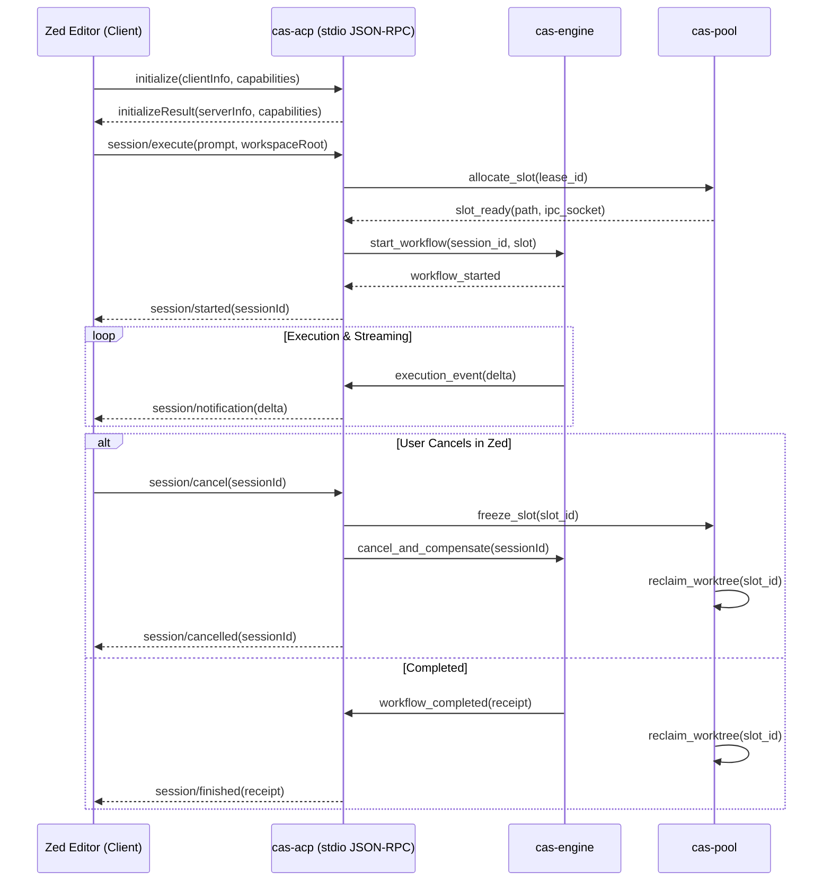

# 0016-zed-agent-communication-protocol

## Overview

Modern agentic code editors (such as Zed and IDE harnesses) communicate with
external agent runtimes using the Agent Communication Protocol (ACP). ACP uses
JSON-RPC 2.0 framing over standard input and output streams.

This spec defines the ACP server in `cas-acp` (Phase 3, CER-2683):
- **CER-2725**: JSON-RPC 2.0 ACP server over stdio.
- **CER-2726**: Workspace session bridging between IDE requests and `cas-engine` workflows.
- **CER-2727**: Slot lease notifications and cooperative cancellation.

## Design

### Decisions

| # | Decision | Who, when |
|---|---|---|
| D1 | Transport: `cas-acp` serves JSON-RPC 2.0 over standard I/O (`stdin` / `stdout`). This matches the standard Zed external agent extension protocol. | CAS lane, 2026-10-09 |
| D2 | Protocol schema: Uses `agent-client-protocol = "2.2.0"` (spec 0004 approved pin). No custom framing formats are introduced. | CAS lane, 2026-10-09 |
| D3 | Workflow bridging: ACP session execution requests map directly into `cas-engine` durable workflows (spec 0006) and execute inside a pooled slot (spec 0015). | CAS lane, 2026-10-09 |
| D4 | Lease notifications: `cas-acp` emits asynchronous notifications (`session/leaseUpdate`) before slot lease expiration, giving the editor a chance to extend or checkpoint. | CAS lane, 2026-10-09 |
| D5 | Cooperative cancellation: A `session/cancel` request suspends the slot via cgroup freezer (spec 0015), runs Saga compensation compensators (spec 0009), and frees resources. | CAS lane, 2026-10-09 |

### Architecture and Flow



### JSON-RPC 2.0 Methods

1. **`initialize`**:
   - Negotiates protocol capabilities, version `2.2.0`.
   - Returns supported features: streaming stdout, file change notifications, tool calling.
2. **`session/execute`**:
   - Accepts prompt text, task parameters, and repository path.
   - Allocates worker slot from `cas-pool`.
   - Launches durable execution in `cas-engine`.
3. **`session/cancel`**:
   - Stops the running task immediately.
   - Thaws process if frozen, executes compensation, cleans up slot.
4. **`session/heartbeat`**:
   - Renews lease timer for active interactive sessions.

### Error Protocol

```rust
#[derive(Debug, thiserror::Error)]
pub enum AcpError {
    #[error("protocol parse error: {0}")]
    Parse(String),
    #[error("method not found: {0}")]
    MethodNotFound(String),
    #[error("invalid parameters: {0}")]
    InvalidParams(String),
    #[error("pool error: {0}")]
    Pool(#[from] cas_pool::PoolError),
    #[error("engine workflow error: {0}")]
    Engine(String),
}
```

Standard JSON-RPC 2.0 error codes are returned over the wire:
- `-32700`: Parse error
- `-32600`: Invalid request
- `-32601`: Method not found
- `-32602`: Invalid parameters
- `-32001`: Capacity limit reached (no slots available)
- `-32002`: Lease expired or cancelled

## Plan

- [ ] Add `agent-client-protocol = "2.2.0"` to `crates/cas-acp/Cargo.toml`.
- [ ] Implement `cas_acp::server::AcpServer` reading from `stdin` and writing to `stdout` (CER-2725).
- [ ] Implement request routing to `cas-engine` workflow triggers (CER-2726).
- [ ] Implement lease warning notifications and cancellation handling (CER-2727).
- [ ] Write integration test `tests/acp_stdio.rs` verifying:
  - Valid `initialize` handshake response.
  - `session/execute` successfully allocates slot and runs mock task.
  - `session/cancel` halts task and reclaims slot.
- [ ] Update `specs/README.md` and `CHANGELOG.md`.

## Test

Run integration and unit tests for `cas-acp`:

```bash
cargo test -p cas-acp -j 2
```

## Notes

- **Zed Compatibility**: Conforms to the standard Zed extension protocol for external agent harnesses.
- **Zero Raw Pointers**: Fully safe Rust without unsafe blocks (`#![forbid(unsafe_code)]`).
