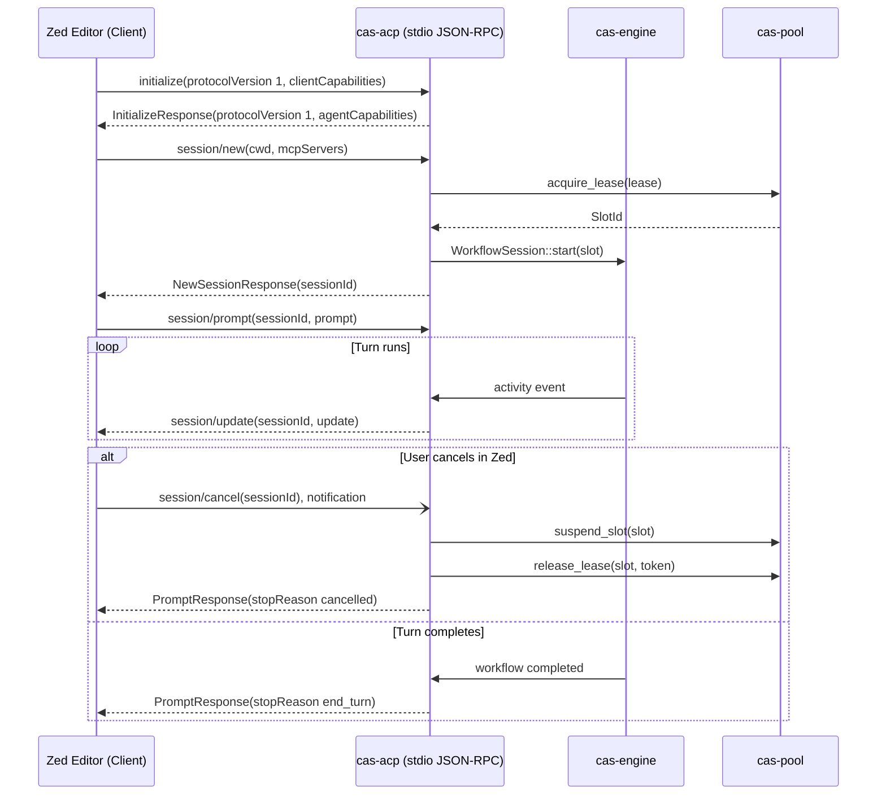

# 0016-zed-agent-communication-protocol

## Overview

Zed and other editors talk to external agent runtimes with the Agent Client
Protocol (ACP). The file name keeps the older name "agent communication
protocol". ACP is JSON-RPC 2.0 over the agent's standard input and output.

This spec defines the ACP server in `cas-acp` (Phase 3, CER-2683):
- JSON-RPC 2.0 ACP server over stdio.
- **CER-2726**: Workspace session bridging between IDE requests and `cas-engine` workflows.
- **CER-2727**: Slot lease notices and cooperative cancellation.

### Amendment A1 (2026-10-10): the methods the pinned crate has

The first draft named `session/execute`, `session/heartbeat` and
`session/leaseUpdate`. The pinned crate has none of them, so the draft
contradicted its own D2. A1 maps the design onto the methods that exist.
Facts, read 2026-10-10 on ceres. `$REG` is
`~/.cargo/registry/src/index.crates.io-1949cf8c6b5b557f`.

- **A1-F1 [verified]:** `agent-client-protocol` 2.2.0 pins the schema crate
  exactly: `$REG/agent-client-protocol-2.2.0/Cargo.toml:201-202`
  (`[dependencies.agent-client-protocol-schema]`, `version = "=1.9.1"`). Its
  default feature set is empty (`Cargo.toml:43-44`).
- **A1-F2 [verified]:** the agent-side methods of schema 1.9.1 are the constants
  in `$REG/agent-client-protocol-schema-1.9.1/src/v1/agent.rs:4753-4787`:
  `initialize`, `authenticate`, `session/new`, `session/load`,
  `session/set_mode`, `session/set_config_option`, `session/prompt`,
  `session/cancel` (a notification), `session/list`, `session/delete`,
  `session/resume`, `session/close`, `logout`. `session/fork` and
  `providers/*` sit behind `unstable_*` features.
- **A1-F3 [verified]:** the client-side methods are in `src/v1/client.rs:2689-2705`:
  `session/update` (a notification), `session/request_permission`,
  `fs/read_text_file`, `fs/write_text_file` and `terminal/*`.
- **A1-F4 [verified]:** `grep -rlE 'session/execute|heartbeat|leaseUpdate'` over
  the `src/` trees of both crates matches 0 files. The control
  `grep -rl 'session/prompt'` over the schema `src/` matches 4 files.
- **A1-F5 [verified]:** `src/version.rs:12-39`: `ProtocolVersion(u16)`, `V1 = 1`,
  `LATEST = V1`. `V2` is a draft behind `unstable_protocol_v2`.
- **A1-F6 [verified]:** `CancelNotification` (`src/v1/agent.rs:5197`) carries a
  `session_id`. `StopReason::Cancelled` (`src/v1/agent.rs:3194-3200`, and the
  notification doc at `:5105`) requires the agent to answer the open
  `session/prompt` request with stop reason `cancelled`.
- **A1-F7 [verified]:** extension method names must start with `_`
  (`src/v1/ext.rs:27-28`).

## Design

### Requirements (EARS)

- **Ubiquitous:** The `cas-acp` server shall speak JSON-RPC 2.0 over stdio, one JSON object per line, with the wire types of `agent-client-protocol` 2.2.0 (schema 1.9.1, `schema::v1`).
- **Event-driven:** WHEN a client sends `initialize`, `cas-acp` shall answer with protocol version 1 (`ProtocolVersion::V1`) and its agent capabilities.
- **Event-driven:** WHEN a client sends `session/new`, `cas-acp` shall acquire a pooled slot, start a `cas-engine` workflow and return the new session id.
- **Event-driven:** WHEN a client sends `session/prompt`, `cas-acp` shall run the turn in that session's slot and answer with a stop reason.
- **State-driven:** WHILE a prompt turn runs, `cas-acp` shall translate engine activity events into `session/update` notifications.
- **Unwanted behavior:** IF a client sends a `session/cancel` notification, THEN `cas-acp` shall freeze the slot, release it, send no response frame for the notification, and answer any open `session/prompt` with stop reason `cancelled`.
- **Unwanted behavior:** IF the pool has no free slot, THEN `session/new` shall fail with error code -32001.
- **Optional feature:** WHERE the crate gains lease methods, or the lane rules on extension methods, `cas-acp` shall send a lease notice before a slot lease expires (Notes, N1).

### Decisions

| # | Decision | Who, when |
|---|---|---|
| D1 | Transport: `cas-acp` serves JSON-RPC 2.0 over standard I/O (`stdin` / `stdout`), one JSON object per line. This matches the Zed external agent protocol. | CAS lane, 2026-10-09 |
| D2 | Wire types and method names come only from `agent-client-protocol` 2.2.0 (schema 1.9.1, `schema::v1`, spec 0004 pin). `cas-acp` serves `initialize`, `session/new`, `session/prompt` and the `session/cancel` notification, and sends `session/update`. `initialize` answers `protocolVersion` = `ProtocolVersion::V1` (the integer 1). No custom framing and no custom methods. | Amended A1: CAS lane w25:p1, 2026-10-10, land on green (the operator can override). Was: CAS lane, 2026-10-09 |
| D3 | Workflow bridging: an ACP "execute" is two calls. `session/new` acquires a slot (spec 0015) and starts the `cas-engine` workflow (spec 0006). `session/prompt` runs one turn in that slot and returns a `stopReason`. | Amended A1: CAS lane w25:p1, 2026-10-10. Was: CAS lane, 2026-10-09 |
| D4 | Lease notices are deferred. Schema 1.9.1 has no lease or heartbeat method (A1-F4). See Notes, N1. | Amended A1: CAS lane w25:p1, 2026-10-10. Was: `session/leaseUpdate`, CAS lane, 2026-10-09 |
| D5 | Cooperative cancellation: `session/cancel` is a notification and gets no response frame. It suspends the slot with the cgroup freezer (spec 0015), then releases it. An open `session/prompt` answers `stopReason: cancelled` (A1-F6). Saga compensation (spec 0009) joins when `cas-engine` has a cancel API (CER-2727). | CAS lane, 2026-10-09; amended A1, CAS lane w25:p1, 2026-10-10 |

### Architecture and Flow



### JSON-RPC 2.0 Methods

All types are in `agent_client_protocol::schema::v1` (A1-F2, A1-F3).

| Method | Direction | Kind | Schema types | `cas-acp` action |
|---|---|---|---|---|
| `initialize` | client to agent | request | `InitializeRequest`, `InitializeResponse` | Answer protocol version 1 and the agent capabilities. |
| `session/new` | client to agent | request | `NewSessionRequest`, `NewSessionResponse` | Acquire a slot, start the workflow, return the session id. |
| `session/prompt` | client to agent | request | `PromptRequest`, `PromptResponse` | Run the turn in the slot; answer with a `stopReason`. |
| `session/cancel` | client to agent | notification | `CancelNotification` | Suspend, then release the slot. No response frame. |
| `session/update` | agent to client | notification | `SessionNotification` | Carry engine activity events during a turn. |

Any other method gets -32601. `cas-acp` builds the schema types with their
`::new(..)` constructors and does not use the crate's connection API.

### Error Protocol

```rust
#[derive(Debug, thiserror::Error)]
pub enum AcpError {
    #[error("protocol parse error: {0}")]
    Parse(String),
    #[error("invalid request: {0}")]
    InvalidRequest(String),
    #[error("method not found: {0}")]
    MethodNotFound(String),
    #[error("invalid parameters: {0}")]
    InvalidParams(String),
    #[error("pool error: {0}")]
    Pool(#[from] cas_pool::PoolError),
    #[error("engine workflow error: {0}")]
    Engine(String),
}
```

Standard JSON-RPC 2.0 error codes are returned over the wire:
- `-32700`: Parse error
- `-32600`: Invalid request
- `-32601`: Method not found
- `-32602`: Invalid parameters
- `-32603`: Internal error (any other pool or engine error)
- `-32001`: Capacity limit reached (`PoolError::CapacityExhausted`)
- `-32002`: Lease expired, no active lease, or token mismatch

## Plan

- [ ] Add `agent-client-protocol = "2.2.0"` to `crates/cas-acp/Cargo.toml`.
- [ ] Implement `cas_acp::server::AcpServer` reading from `stdin` and writing to `stdout`.
- [ ] Implement `session/new` and `session/prompt` routing to `cas-engine` workflows (CER-2726).
- [ ] Implement `session/cancel`: freeze, then release; compensation waits on CER-2727.
- [ ] Write integration test `tests/acp_stdio.rs` verifying:
  - `initialize` answers protocol version 1 and echoes the request id.
  - `session/new` acquires one slot and returns a session id.
  - `session/new` with no free slot fails with -32001.
  - `session/cancel` suspends, then releases the slot, and sends no frame for the notification.
  - An unknown method gets -32601; malformed JSON gets -32700.
- [ ] Lease notices: wait on N1.
- [ ] Update `specs/README.md` and `CHANGELOG.md`.

## Test

Run integration and unit tests for `cas-acp`:

```bash
cargo test -p cas-acp -j 2
```

## Notes

- **N1, lease notices (deferred by A1):** `session/heartbeat` (renew a lease)
  and `session/leaseUpdate` (warn before expiry) are not ACP methods in schema
  1.9.1. They become custom extension methods only when the crate adds an
  equivalent or the lane rules on extensions. An extension name must start
  with `_` (A1-F7); this spec does not choose the name.
- **Cancel and the open prompt:** the notification itself gets no frame. The
  open `session/prompt` still gets a `PromptResponse` with `stopReason:
  cancelled`. A test that sends a cancel with no prompt in flight sees no
  frame at all.
- **Zed compatibility:** follows the Zed external agent protocol.
- **No unsafe code:** the workspace forbids `unsafe` (AGENTS.md rule 14).
