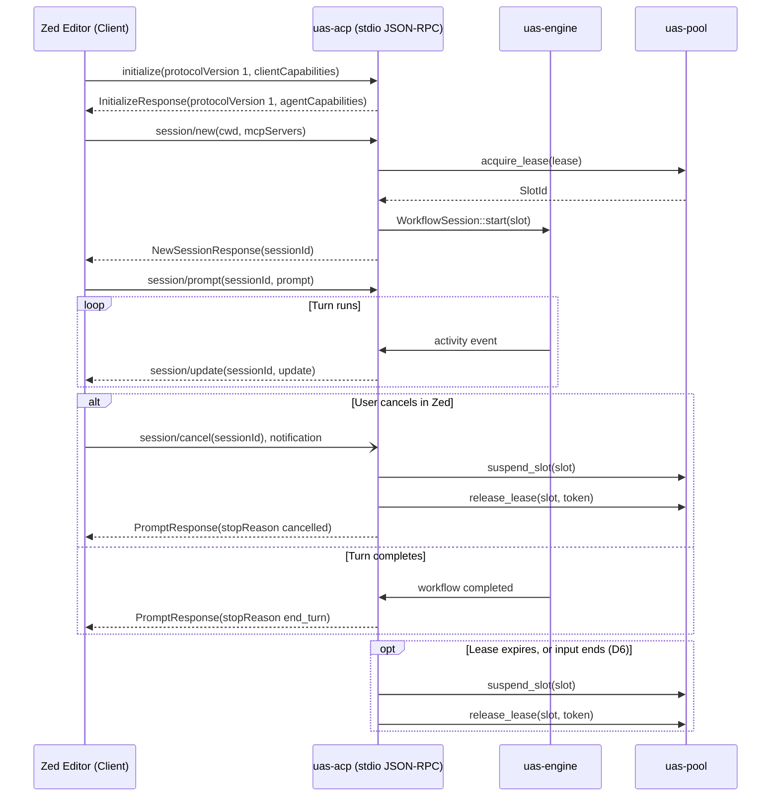

<!-- SPDX-License-Identifier: CC-BY-4.0 -->

# 0016-zed-agent-communication-protocol

## Overview

Zed and other editors talk to external agent runtimes with the Agent Client
Protocol (ACP). The file name keeps the older name "agent communication
protocol". ACP is JSON-RPC 2.0 over the agent's standard input and output.

This spec defines the ACP server in `uas-acp` (Phase 3, CER-2683):
- JSON-RPC 2.0 ACP server over stdio.
- **CER-2726**: Workspace session bridging between IDE requests and `uas-engine` workflows.
- **CER-2727**: Slot lease notices and cooperative cancellation.

### Amendment A1 (2026-10-10): the methods the pinned crate has

The first draft named `session/execute`, `session/heartbeat` and
`session/leaseUpdate`. The pinned crate has none of them, so the draft
contradicted its own D2. A1 maps the design onto the methods that exist.
Facts, read 2026-10-10 on ceres. `$REG` is
`~/.cargo/registry/src/index.crates.io-1949cf8c6b5b557f`.

- **A1-F1 [verified]:** `agent-client-protocol` 2.2.0 pins the schema crate
  exactly: `$REG/agent-client-protocol-2.2.0/Cargo.toml:201-202`
  (`[dependencies.agent-client-protocol-schema]`, `version = "=1.9.1"`). Its
  default feature set is empty (`Cargo.toml:43-44`).
- **A1-F2 [verified]:** the agent-side methods of schema 1.9.1 are the constants
  in `$REG/agent-client-protocol-schema-1.9.1/src/v1/agent.rs:4753-4787`:
  `initialize`, `authenticate`, `session/new`, `session/load`,
  `session/set_mode`, `session/set_config_option`, `session/prompt`,
  `session/cancel` (a notification), `session/list`, `session/delete`,
  `session/resume`, `session/close`, `logout`. `session/fork` and
  `providers/*` sit behind `unstable_*` features.
- **A1-F3 [verified]:** the client-side methods are in `src/v1/client.rs:2689-2705`:
  `session/update` (a notification), `session/request_permission`,
  `fs/read_text_file`, `fs/write_text_file` and `terminal/*`.
- **A1-F4 [verified]:** `grep -rlE 'session/execute|heartbeat|leaseUpdate'` over
  the `src/` trees of both crates matches 0 files. The control
  `grep -rl 'session/prompt'` over the schema `src/` matches 4 files.
- **A1-F5 [verified]:** `src/version.rs:12-39`: `ProtocolVersion(u16)`, `V1 = 1`,
  `LATEST = V1`. `V2` is a draft behind `unstable_protocol_v2`.
- **A1-F6 [verified]:** `CancelNotification` (`src/v1/agent.rs:5197`) carries a
  `session_id`. `StopReason::Cancelled` (`src/v1/agent.rs:3194-3200`, and the
  notification doc at `:5105`) requires the agent to answer the open
  `session/prompt` request with stop reason `cancelled`.
- **A1-F7 [verified]:** extension method names must start with `_`
  (`src/v1/ext.rs:27-28`).

### Amendment A2 (2026-10-10): slot release on session end

The landed server releases a slot only on `session/cancel`. A client that
disconnects, or a session whose lease expires, keeps its slot. A2 adds D6.
Facts, read 2026-10-10 on ceres with `grep -n` and `sed -n`, at
`origin/development` 23b81d4. `$REG` is as in A1.

- **A2-F1 [verified]:** `crates/uas-acp/src/server.rs:156` is
  `Frame::End => break`. `serve` returns at the end of input and keeps every
  session. Only `session_cancel` (`server.rs:293-313`) calls release.
- **A2-F2 [verified]:** `SlotPool::sweep` (`crates/uas-pool/src/slot.rs:410-443`)
  lists expired leases and changes nothing. `acquire_lease` refuses a slot that
  holds an unexpired lease, or that is not `Warm` (`slot.rs:181-197`). An
  expired lease that nobody releases blocks its slot.
- **A2-F3 [verified]:** `release_lease` (`slot.rs:332-362`) checks the token,
  not the expiry. The holder can release an expired lease. It stops no worker.
- **A2-F4 [verified]:** `Lease::is_expired` (`crates/uas-domain/src/lease.rs:275-277`)
  is `now >= expires_at`.
- **A2-F5 [verified]:** `session/close` is a request, not a notification
  (`CloseSessionRequest`, `$REG/agent-client-protocol-schema-1.9.1/src/v1/agent.rs:1443-1470`;
  its dispatch arm at `:5002` has no `cfg` gate). A client sends it only when
  the agent advertises `sessionCapabilities.close` (`:4090-4097`).
  `InitializeResponse::new` sets `AgentCapabilities::default()` (`:170-177`), so
  `uas-acp` does not advertise it. A `session/close` gets -32601 today.
- **A2-F6 [verified]:** `uas_engine::SessionState` has no expired state
  (`crates/uas-engine/src/session.rs:49-60`). "Expired" is a `uas-acp` end mark.

## Design

### Requirements (EARS)

- **Ubiquitous:** The `uas-acp` server shall speak JSON-RPC 2.0 over stdio, one JSON object per line, with the wire types of `agent-client-protocol` 2.2.0 (schema 1.9.1, `schema::v1`).
- **Event-driven:** WHEN a client sends `initialize`, `uas-acp` shall answer with protocol version 1 (`ProtocolVersion::V1`) and its agent capabilities.
- **Event-driven:** WHEN a client sends `session/new`, `uas-acp` shall acquire a pooled slot, start a `uas-engine` workflow and return the new session id.
- **Event-driven:** WHEN a client sends `session/prompt`, `uas-acp` shall run the turn in that session's slot and answer with a stop reason.
- **State-driven:** WHILE a prompt turn runs, `uas-acp` shall translate engine activity events into `session/update` notifications.
- **Unwanted behavior:** IF a client sends a `session/cancel` notification, THEN `uas-acp` shall freeze the slot, release it, send no response frame for the notification, and answer any open `session/prompt` with stop reason `cancelled`.
- **Unwanted behavior:** IF the pool has no free slot, THEN `session/new` shall fail with error code -32001.
- **Event-driven (D6a):** WHEN `uas-acp` reads a frame, or its caller calls `tick`, `uas-acp` shall read the clock once and, before it handles the frame, end every session whose lease is expired at that time (A2-F4): suspend the slot, release it, and mark the session `Expired`.
- **Event-driven (D6b):** WHEN the input ends, or a read or a write on the transport fails, `uas-acp` shall suspend and release the slot of every live session, mark each one `Disconnected`, and then return.
- **State-driven (D6c):** WHILE a session has no prompt turn in flight, `uas-acp` shall keep its slot leased until the lease expires, a `session/cancel` arrives, or the input ends.
- **Unwanted behavior:** IF a `session/cancel` names a session that has ended, THEN `uas-acp` shall make no pool call and send no frame.
- **Unwanted behavior:** IF a suspend or a release fails while a session ends by expiry or by end of input, THEN `uas-acp` shall write the error to stderr, still end the session, and go on to the next one.
- **Optional feature:** WHERE the crate gains lease methods, or the lane rules on extension methods, `uas-acp` shall send a lease notice before a slot lease expires (Notes, N1).

### Decisions

| # | Decision | Who, when |
|---|---|---|
| D1 | Transport: `uas-acp` serves JSON-RPC 2.0 over standard I/O (`stdin` / `stdout`), one JSON object per line. This matches the Zed external agent protocol. | UAS lane, 2026-10-09 |
| D2 | Wire types and method names come only from `agent-client-protocol` 2.2.0 (schema 1.9.1, `schema::v1`, spec 0004 pin). `uas-acp` serves `initialize`, `session/new`, `session/prompt` and the `session/cancel` notification, and sends `session/update`. `initialize` answers `protocolVersion` = `ProtocolVersion::V1` (the integer 1). No custom framing and no custom methods. | Amended A1: UAS lane w25:p1, 2026-10-10, land on green (Christian can override). Was: UAS lane, 2026-10-09 |
| D3 | Workflow bridging: an ACP "execute" is two calls. `session/new` acquires a slot (spec 0015) and starts the `uas-engine` workflow (spec 0006). `session/prompt` runs one turn in that slot and returns a `stopReason`. | Amended A1: UAS lane w25:p1, 2026-10-10. Was: UAS lane, 2026-10-09 |
| D4 | Lease notices are deferred. Schema 1.9.1 has no lease or heartbeat method (A1-F4). See Notes, N1. | Amended A1: UAS lane w25:p1, 2026-10-10. Was: `session/leaseUpdate`, UAS lane, 2026-10-09 |
| D5 | Cooperative cancellation: `session/cancel` is a notification and gets no response frame. It suspends the slot with the cgroup freezer (spec 0015), then releases it. An open `session/prompt` answers `stopReason: cancelled` (A1-F6). Saga compensation (spec 0009) joins when `uas-engine` has a cancel API (CER-2727). | UAS lane, 2026-10-09; amended A1, UAS lane w25:p1, 2026-10-10 |
| D6 | Slot release on session end (A2). (a) Lease expiry: the server checks every live lease once per frame read, before it handles the frame, and in `tick()`, which the caller drives. The clock is `AcpConfig.clock`. An expired session is suspended, released and marked `Expired`. (b) End of input, or a read or write error: every live session is suspended, released and marked `Disconnected`, best effort, errors to stderr. In (a) and (b) a failed release still ends the session: a retry on every frame repeats the error, and the pool refuses to lease a slot it still holds (A2-F2). (c) The end of a prompt turn is idle, not close. No custom method. `session/close` is a request behind a capability `uas-acp` does not advertise (A2-F5); serving it is out of scope here. D5 is unchanged. | UAS lane w25:p1, 2026-10-10, land on green (Christian can override) |

### Architecture and Flow



### JSON-RPC 2.0 Methods

All types are in `agent_client_protocol::schema::v1` (A1-F2, A1-F3).

| Method | Direction | Kind | Schema types | `uas-acp` action |
|---|---|---|---|---|
| `initialize` | client to agent | request | `InitializeRequest`, `InitializeResponse` | Answer protocol version 1 and the agent capabilities. |
| `session/new` | client to agent | request | `NewSessionRequest`, `NewSessionResponse` | Acquire a slot, start the workflow, return the session id. |
| `session/prompt` | client to agent | request | `PromptRequest`, `PromptResponse` | Run the turn in the slot; answer with a `stopReason`. |
| `session/cancel` | client to agent | notification | `CancelNotification` | Suspend, then release the slot. No response frame. |
| `session/update` | agent to client | notification | `SessionNotification` | Carry engine activity events during a turn. |

Any other method gets -32601. `uas-acp` builds the schema types with their
`::new(..)` constructors and does not use the crate's connection API.

### Error Protocol

```rust
#[derive(Debug, thiserror::Error)]
pub enum AcpError {
    #[error("protocol parse error: {0}")]
    Parse(String),
    #[error("invalid request: {0}")]
    InvalidRequest(String),
    #[error("method not found: {0}")]
    MethodNotFound(String),
    #[error("invalid parameters: {0}")]
    InvalidParams(String),
    #[error("pool error: {0}")]
    Pool(#[from] uas_pool::PoolError),
    #[error("engine workflow error: {0}")]
    Engine(String),
}
```

Standard JSON-RPC 2.0 error codes are returned over the wire:
- `-32700`: Parse error
- `-32600`: Invalid request
- `-32601`: Method not found
- `-32602`: Invalid parameters
- `-32603`: Internal error (any other pool or engine error)
- `-32001`: Capacity limit reached (`PoolError::CapacityExhausted`)
- `-32002`: Lease expired, no active lease, or token mismatch

## Plan

- [ ] Add `agent-client-protocol = "2.2.0"` to `crates/uas-acp/Cargo.toml`.
- [ ] Implement `uas_acp::server::AcpServer` reading from `stdin` and writing to `stdout`.
- [ ] Implement `session/new` and `session/prompt` routing to `uas-engine` workflows (CER-2726).
- [ ] Implement `session/cancel`: freeze, then release; compensation waits on CER-2727.
- [ ] Write integration test `tests/acp_stdio.rs` verifying:
  - `initialize` answers protocol version 1 and echoes the request id.
  - `session/new` acquires one slot and returns a session id.
  - `session/new` with no free slot fails with -32001.
  - `session/cancel` suspends, then releases the slot, and sends no frame for the notification.
  - An unknown method gets -32601; malformed JSON gets -32700.
- [ ] Lease notices: wait on N1.
- [ ] D6: expiry per frame and in `tick()`, release on end of input and on a
  transport error, `SessionEnd` marks, and a public `handle_frame` (brief P2b).
- [ ] Update `specs/README.md` and `CHANGELOG.md`.

## Test

Run integration and unit tests for `uas-acp`:

```bash
cargo test -p uas-acp -j 2
```

Test rows for D6, in `crates/uas-acp/tests/acp_stdio.rs`. The clock reads a
thread-local cell. Leases run from t=1000 for 600 s.

- `lease_expiry_boundary_releases_on_next_frame`: one slot. At t=1599 a second
  `session/new` gets -32001 (the control). At t=1600 it succeeds. The pool log
  is acquire, suspend, release, acquire. The first session is `Expired`.
- `tick_expires_without_a_frame`: at t=1600, `tick()` returns the session id and
  releases its slot. A second `tick()` returns nothing and calls no pool method.
- `eof_releases_every_session`: two slots, two sessions. The end of input
  suspends and releases both, and marks both `Disconnected`.
- `transport_error_releases_every_session`: input `session/new`, a writer that
  fails. `serve` returns `Err`. The log is acquire, suspend, release.
- `eof_release_failure_still_ends_the_session`: the mock release fails. Both
  sessions still end, and the log has two release calls.
- `cancel_freezes_then_releases` (kept): through `handle_frame`, the log is
  exactly acquire, suspend, release. The session is `Cancelled`. No frame.
- `expired_session_cancel_is_a_noop`: a frame at t=1600 expires the session.
  Take the log, then send the cancel: no new pool call, no frame, and the mark
  stays `Expired`.

## Notes

- **N1, lease notices (deferred by A1):** `session/heartbeat` (renew a lease)
  and `session/leaseUpdate` (warn before expiry) are not ACP methods in schema
  1.9.1. They become custom extension methods only when the crate adds an
  equivalent or the lane rules on extensions. An extension name must start
  with `_` (A1-F7); this spec does not choose the name.
- **Cancel and the open prompt:** the notification itself gets no frame. The
  open `session/prompt` still gets a `PromptResponse` with `stopReason:
  cancelled`. A test that sends a cancel with no prompt in flight sees no
  frame at all.
- **N2, the tick and a blocking read (D6a):** `serve` holds the server and
  blocks in `read`. Under `serve_stdio`, an idle session's slot returns at the
  next frame or at the end of input, not at its expiry second. Only a caller
  that owns its loop (`handle_frame` and `tick`) expires on time. A timer
  thread or an async reader is a later decision.
- **N3, no renewal:** no ACP method renews a lease (N1). A busy session also
  ends at `lease_secs`. Revisit when `session/prompt` lands.
- **N4, end marks:** the server keeps one `SessionEnd` mark per ended session
  for its life. A later `session/prompt` can then tell an expired session from
  an unknown one.
- **N5, workers:** release returns the slot to `Warm` and stops no worker
  (A2-F3). Reaping belongs to the spec 0015 reclaim row.
- **Zed compatibility:** follows the Zed external agent protocol.
- **No unsafe code:** the workspace forbids `unsafe` (AGENTS.md rule 14).
