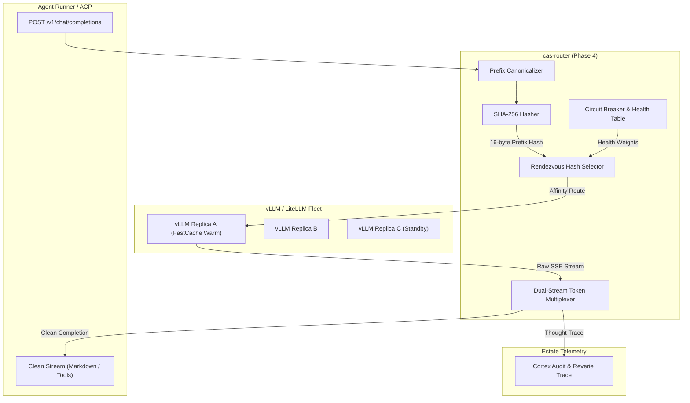

# 0017-fastcache-prefix-hashing-and-affinity-routing

## Overview

CAS agent runners make frequent LLM completions. Every agent turn sends a large
prompt prefix. This prefix includes system rules, tool definitions, and LeanSpecs.
Re-computing KV-cache tokens across vLLM replicas wastes GPU memory and compute.

This spec defines intelligent model call routing in `cas-router`:
- **CER-2729**: Canonical prompt prefix serializer and SHA-256 hasher.
- **CER-2730**: Consistent hash ring with replica affinity and cache hit scoring.
- **CER-2731**: Dual-stream token multiplexer for cognitive `<think>` telemetry.
- **CER-2732**: Active replica health probing and zero-interruption circuit breaking.

Parent tickets: CER-2690, CER-2691, CER-2692, CER-2693.

Facts, measured and recorded 2026-10-09:
- **Upstream Gateway [verified]:** Estate LLM gateway operates at
  `http://llm.tail769bd2.ts.net` and in-cluster at `http://llm.llm:4000`.
- **Approved Crates [verified]:** Spec 0004 approves `sha2` 0.11.0 and
  `futures-util` 0.3.34 for `cas-router`. `tokio` 1.53.1 is in use.
- **Domain Purity [verified]:** `cas-router` depends on `cas-domain` for
  session identifiers and slot leases. It performs asynchronous network I/O.
- **Cognitive Tag Conventions [reported]:** Reasoning models emit thinking
  tokens wrapped in `<think>...</think>` XML-like blocks.

## Design

### Decisions

| # | Decision | Who, when |
|---|---|---|
| D1 | Canonical prefix serialization: Sort tool schemas alphabetically by name. Normalize system instructions to deterministic UTF-8 bytes before hashing. | CAS lane, 2026-10-09 |
| D2 | SHA-256 prefix hash: Hash the invariant prefix with `sha2` 0.11.0. Use the first 16 bytes as the affinity routing key. | CAS lane, 2026-10-09 |
| D3 | Rendezvous routing: Use Highest Random Weight (HRW) rendezvous hashing across active replica nodes. Achieve deterministic sticky routing without centralized state. | CAS lane, 2026-10-09 |
| D4 | Dual-stream token multiplexer: Intercept streaming SSE chunks. Parse and strip `<think>` blocks. Route thought traces to telemetry and clean completions to client. | CAS lane, 2026-10-09 |
| D5 | Active health probe: Probe replica `/healthz` or `/health` every 5 seconds. Mark replica unavailable after 2 consecutive failures. Fail over in-flight requests. | CAS lane, 2026-10-09 |
| D6 | Zero-allocation buffer: Use circular byte window for streaming token parsing. Detect boundary tags without heap allocations. | CAS lane, 2026-10-09 |

### Architecture and Flow



### Components

#### 1. Prefix Canonicalizer & Hasher (`prefix.rs`)
- Parses incoming JSON request payloads for `/v1/chat/completions`.
- Extracts `messages` where role is `system` or developer instructions.
- Extracts `tools` definitions. Sorts tools by function `name`.
- Serializes canonical UTF-8 representation:
  `SYS:<system_content>|TOOLS:<tool1_name>:<tool1_json>|...`
- Computes SHA-256 digest via `sha2::Sha256`.
- Emits `PrefixHash([u8; 16])`.

#### 2. Consistent Rendezvous Router (`affinity.rs`)
- Implements Highest Random Weight (HRW) hashing.
- For a given `PrefixHash` and replica list:
  `weight(node, hash) = hash64(node_id || prefix_hash)`
- Selects replica with highest weight.
- When an active replica fails, requests route smoothly to next highest replica.
- Minimal cache disruption during node additions or removals.

#### 3. Dual-Stream Token Multiplexer (`multiplexer.rs`)
- Receives raw Server-Sent Events (`data: {"choices":[{"delta":{"content":"..."}}]}`).
- Maintains state machine: `Initial`, `Thinking`, `Completion`.
- Detects opening `<think>` tag. Diverts subsequent tokens to telemetry channel.
- Detects closing `</think>` tag. Diverts subsequent tokens to output client channel.
- Emits `ThoughtChunk` to internal logging channel and `CleanChunk` to client stream.

#### 4. Active Health Monitor (`health.rs`)
- Background task probes replica endpoints with HTTP `GET /healthz`.
- Interval: 5000 milliseconds. Timeout: 1000 milliseconds.
- Thresholds: 2 consecutive failures mark node unhealthy; 3 consecutive successes restore node.
- Unhealthy nodes are excluded from HRW candidate set.

### Invariants

1. **Deterministic Hashing:** Identical system prompts and tool sets always yield identical `PrefixHash` values.
2. **Transparent Fallback:** If all affinity replicas are unhealthy, the router falls back to round-robin among any responsive upstream node.
3. **Stream Purity:** Client streams never receive unclosed or raw `<think>` tags when dual-streaming is active.
4. **Host Throttling:** Network polling and multiplexing run on asynchronous Tokio tasks without blocking OS threads.

### Errors

- `RouterError::InvalidPayload`: Malformed JSON or missing completion fields.
- `RouterError::NoHealthyReplicas`: All upstream inference nodes failed health probes.
- `RouterError::UpstreamTimeout`: Target replica did not respond within configured timeout.
- `RouterError::StreamTerminated`: Upstream disconnected mid-completion.

## Plan

- [ ] Add `sha2 = { version = "0.11.0", default-features = false }` to workspace dependencies.
- [ ] Add `futures-util = { version = "0.3.34", default-features = false }` to workspace dependencies.
- [ ] Implement `cas-router::prefix::PrefixHasher` with JSON canonicalization.
- [ ] Implement `cas-router::affinity::RendezvousRouter` with node health weights.
- [ ] Implement `cas-router::multiplexer::DualStreamMultiplexer` state machine.
- [ ] Implement `cas-router::health::HealthMonitor` background prober.
- [ ] Unit and property tests:
  - Tool ordering permutations produce identical `PrefixHash`.
  - Node removal moves only 1/N keys in HRW ring.
  - Streaming token splitter properly extracts `<think>` blocks without dropping surrounding text.
- [ ] Update `specs/README.md` and roadmap artifacts.

## Test

```bash
cargo test -p cas-router -j 2
```

## Notes

- **PagedAttention Synergy:** vLLM caches KV blocks by hash of prompt token prefixes.
  Consistent routing ensures agent sessions reuse KV cache blocks across turns.
- **LiteLLM Compatibility:** Request and response framing complies with OpenAI
  v1 Chat Completions specification.
