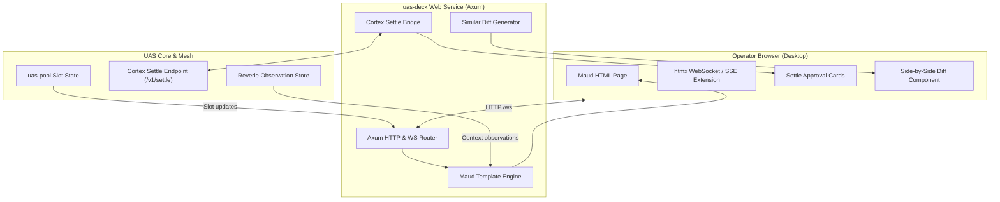

<!-- SPDX-License-Identifier: CC-BY-4.0 -->

# 0018-mad-stack-operator-deck-and-settle-queue

## Overview

UAS agents execute speculative compute and multi-step workflows. Irreversible
actions (e.g., git push to main, OpenBao secret rotations, cluster deploys) require
human-in-the-loop approval. The estate operator needs a live dashboard to inspect
running agent slots, review diffs, and approve settle cards.

This spec defines the operator interface in `uas-deck`:
- **CER-2733**: Axum web service and Maud compile-time HTML components.
- **CER-2734**: Real-time SSE and WebSocket stream with htmx fragment swap.
- **CER-2735**: Cortex settle queue client (`/v1/settle/pending`) and approval UI.
- **CER-2736**: Interactive split diff viewer and verification evidence badge display.

Parent tickets: CER-2694, CER-2695, CER-2696, CER-2697.

Facts, measured and recorded 2026-10-09:
- **Zero-Node Decision [verified]:** Spec 0001 and research require pure Rust
  MAD stack (Maud, Axum, Datastar/htmx). No Node.js runtime or npm dependencies.
- **Approved Crates [verified]:** Spec 0004 approves `axum` 0.8.9, `maud` 0.27.0,
  `tower-http` 0.7.1, `similar` 3.2.0, and `tokio-stream` 0.1.19 for `uas-deck`.
- **Cortex Settle API (retracted 2026-10-10, lane w25:p1, our error):** this row
  said `[verified]` that Cortex exposes `/v1/settle/pending` and
  `/v1/settle/decision` over a Unix domain socket or local HTTP. No command backed
  it. Cortex has no `/decision` route. A decision is `POST /v1/settle/{job_id}`
  over HTTP with a bearer token (A1-F1, A1-F5).
- **Controlled Language [verified]:** UI labels and status badges adhere to
  ASD-STE100 and evidence tier definitions (`verified`, `reported`, `heuristic`, `asserted`).

### Amendment A1 (2026-10-10): the Cortex settle contract

Slice 1 (PR #68) renders `uas_engine::SettleCard`. That type is not the Cortex
contract. A1 records the contract and maps it to one deck card. It also closes
two gaps in the first draft: the card fields, and Request-Info against Hold.
Lane w25:p1 wrote A1; the operator may override any part. `cortex@a91ffd8` is
`cerebral-work/cortex` at a91ffd8, read on ceres with `git show`. `git ls-remote`
showed it as `main` on 2026-10-10.

- **A1-F1 [reported 2026-10-10, mesh 312c8269-e688-43d2-bae5-129f9eb9c7da, cortex lane]:**
  `GET /v1/settle/pending` exists (`crates/cortex-api/src/routes.rs:89`). It takes
  no parameters and no body. The response is `{by_source, plans, total}`. An
  empty queue is `{"by_source": {}, "plans": [], "total": 0}`. Each card is a
  `SettleJobView`: `job_id`, `source`, `changeset{run_hash, description,
  diff_stat}`, `guard_decision{allow, rule_id, reason}`, `settle_url`,
  `created_at` (RFC 3339), `age_secs` (i64), `needs_attention` (true past 24 h),
  `plan{plan_id, step_index, step_count}`, `detail`, `refs`, `custody`.
- **A1-F2 [reported, `cortex@a91ffd8:crates/cortex-api/src/settle.rs:67-87`]:**
  `plans` is a list of `PlanView{plan_id, step_count, active_step}`.
  `active_step` is a `SettleJobView`. A plan step is not in `by_source`. `total`
  counts every pending job once, standalone and plan steps.
- **A1-F3 [reported, `cortex@a91ffd8:crates/cortex-worker/src/settle.rs:96-166`]:**
  `diff_stat`, `plan`, `detail`, `refs` and `custody` are left out of the JSON
  when empty. The mesh reply says `null`. A reader must accept both.
- **A1-F4 [reported, `cortex@a91ffd8:crates/cortex-worker/src/settle.rs:46-56`
  and `web/src/lib/api.ts:10`]:** the GitHub source is `git_hub` on the wire, not
  `github`. The other sources are `email`, `calendar`, `linear` and `session`.
- **A1-F5 [reported, `cortex@a91ffd8:crates/cortex-api/src/routes.rs:144-157,208-342`
  and `settle.rs:99-103`]:** a store error on the pending route is HTTP 503, never
  an empty queue. The pending handler takes no auth header, and the binary adds
  only a CORS layer (`bin/cortex-api.rs:215,319`). Auth at the network edge was
  not checked. Cortex rewrites
  `settle_url` at read time to `{base}/v1/settle/{job_id}`: an absolute URL when a
  base is set. A decision is `POST /v1/settle/{job_id}` with `{action, peer_id}`
  and a registered mesh peer bearer token. With no verifier it fails closed (503).
  `apply` is refused (422). A `session` card settles as advisory: Cortex records
  it and calls no blackwall. The `custody` doc says a deck shows no sign button
  on a `fleet:*` card.
- **A1-F6 [verified 2026-10-10, `sed -n 96,115p crates/uas-engine/src/cortex.rs` at 36e3af2]:**
  `SettleCard` has `id`, `session_id`, `step_id`, `title`, `rationale`,
  `diff_summary`, `status` and `created_at` (epoch seconds). Its doc says it
  matches the `/v1/settle/pending` contract. It does not. Component 3 named
  `lane`, `action_type`, `evidence_tier` and `diff`. The contract has none of them.
- **A1-F7 [reported, `cortex@a91ffd8:crates/cortex-api/src/routes.rs:114-142`]:**
  Cortex `GET /v1/settle/{job_id}` redirects to `{deck}/#settle/{job_id}`. Cortex
  has its own web deck (`web/src/lib/components/SettleCard.svelte`).
- **A1-F8 [verified 2026-10-10, `grep -n` in `axum-0.8.9/src/routing/path_router.rs:58`]:**
  axum 0.8.9 rejects a path segment that starts with `:`. A capture is `{name}`.

## Design

### Requirements (EARS)

- **Ubiquitous:** The `uas-deck` dashboard shall render operator UI components using Axum and Maud without Node.js dependencies.
- **Ubiquitous:** The dashboard shall display verification evidence tiers with standard badge colors (Green for `verified`).
- **Ubiquitous:** The dashboard shall map each Cortex `SettleJobView` to one deck card, with `job_id` as the card id (D7).
- **Event-driven:** WHEN an operator submits Approve or Reject, `uas-deck` shall forward `select` or `discard` to Cortex (D8).
- **Event-driven:** WHEN an operator submits Hold, `uas-deck` shall keep the card pending in Cortex and send no request (D8).
- **State-driven:** WHILE streaming slot telemetry, the dashboard shall push live updates over Server-Sent Events to htmx frontends.
- **State-driven:** WHILE a card has `needs_attention` set, the dashboard shall highlight the card.
- **Unwanted behavior:** IF communication with Cortex fails, THEN the dashboard shall display an error notification and prevent submissions.
- **Unwanted behavior:** IF the Cortex response does not parse as the contract, THEN the dashboard shall show the disconnected notice and no card (D10).
- **Optional feature:** WHERE a card's `custody` starts with `fleet:`, the dashboard shall show no Approve action on that card (D8).

### Decisions

| # | Decision | Who, when |
|---|---|---|
| D1 | Pure Rust hypermedia: Render all HTML at compile time with `maud` macros. Serve via `axum` routes with `htmx` for dynamic browser updates. | Spec 0001 & the operator, 2026-10-09 |
| D2 | Real-time event transport: Use Server-Sent Events (`GET /events`) for slot lifecycle telemetry and WebSocket for bidirectional settle actions. | UAS lane, 2026-10-09 |
| D3 | Cortex settle integration: Poll and stream pending settle items from Cortex. Provide one-click Approve, Reject, and Hold actions. | UAS lane, 2026-10-09. Amended 2026-10-10, lane w25:p1, the operator may override: Request-Info is Hold (D8). |
| D4 | In-process diff rendering: Compute syntactic diffs using `similar` 3.2.0. Render side-by-side unified diffs with line numbering in pure Maud. | UAS lane, 2026-10-09 |
| D5 | Evidence badge hierarchy: Display colored badges for evidence tiers: Green (`verified`), Blue (`reported`), Yellow (`heuristic`), Gray (`asserted`). | AGENTS.md rule 3 & UAS lane, 2026-10-09 |
| D6 | Asset bundling: Embed minimal CSS and `htmx.min.js` directly into the binary using `include_str!`. Zero runtime external network dependencies. | UAS lane, 2026-10-09 |
| D7 | One deck card type, owned by `uas-deck`. The Cortex `SettleJobView` maps to it by the table in Component 3. `uas_engine::SettleCard` maps to it too, so the in-process queue stays. No settle type goes into `uas-domain` or `uas-engine`. Component 3's `lane`, `action_type`, `evidence_tier` and `diff` are dropped: the contract has none of them (A1-F6). The card badge is the guard decision. Evidence badges stay on session rows (D5). | lane w25:p1, 2026-10-10 (the operator may override) |
| D8 | Actions: Approve sends `select`. Reject sends `discard`. Hold sends nothing: the card stays pending in Cortex, and the deck marks it held in memory. Request-Info is dropped: Cortex has no such verb, and a settle click must not become a channel into a session (A1-F5). The deck never sends `apply` (422). A `fleet:*` card gets no Approve. No action ships before Invariant 2 is ruled. | lane w25:p1, 2026-10-10 (the operator may override) |
| D9 | Source seam: the `SettleSource` trait stays, and the in-process `SettleQueue` stays the default. A Cortex source parses the JSON body that a fetch trait returns. The fetch trait is sync. The HTTP slice adds a task that polls Cortex and keeps the last body or error; the fetch reads that snapshot, so the trait does not change again. That slice needs `reqwest` 0.13.5 (spec 0004; `rustls`, `json`), not yet in the workspace. Tests read fixture files and open no socket to Cortex. | lane w25:p1, 2026-10-10 (the operator may override) |
| D10 | Contract parsing: each optional field reads absent and `null` as none (A1-F3). Unknown fields are ignored. `source` stays a string, shown as sent, so a new source (or `git_hub`, A1-F4) cannot fail the queue. `created_at` stays text and the card shows `age_secs`; no time crate. Cards are `by_source` in key order, then each plan's `active_step`. When `total` differs from the card count, the deck shows a count notice. Any fetch or parse error shows the disconnected notice and no card. | lane w25:p1, 2026-10-10 (the operator may override) |
| D11 | Two decks (A1-F7): `uas-deck` replaces the Cortex web deck, or sits next to it and takes the `{deck}/#settle/{job_id}` links. **Ruled: beside it, as a read-only operator surface.** Actions stay on the Cortex web deck until Invariant 2 (auth, the Director of Engineering's veto area) is settled; D8 waits on Invariant 2 only. | The operator, 2026-10-10, in session (lane w25:p1 interview) |

### Architecture and Flow



### Components

#### 1. Axum Web Service & Maud Templates (`server.rs`, `views/`)
- HTTP service listening on configurable address (default `127.0.0.1:3000`).
- Routes use the axum 0.8 capture syntax `{card_id}` (A1-F8):
  - `GET /`: Main dashboard view showing active slots, memory usage, and settle queue.
  - `GET /slots`: Fragment returning active worker slot table.
  - `GET /settle`: Fragment returning pending settle approval cards.
  - `GET /diff/{card_id}`: Modal fragment showing side-by-side diff.
  - `POST /settle/{card_id}/approve`: Sends `select` to Cortex (D8).
  - `POST /settle/{card_id}/reject`: Sends `discard` to Cortex (D8).
  - `POST /settle/{card_id}/hold`: Marks the card held in the deck. No Cortex call (D8).
  - `GET /events`: SSE stream carrying live slot state transitions.

#### 2. Live Fragment Streaming (`events.rs`)
- Uses `axum::response::sse::Sse` and `tokio_stream::wrappers::BroadcastStream`.
- Broadcasts typed domain events (`SlotAllocated`, `SlotFrozen`, `SettleQueued`, `SettleResolved`).
- Maud renders HTML fragment directly into SSE data payload.
- Browser `htmx` swaps targeted DOM elements without page reload.

#### 3. Cortex Settle Bridge (`settle.rs`, `cortex.rs`)
- Reads `GET /v1/settle/pending` (A1-F1 to A1-F5) through the fetch trait (D9).
- Maps each `SettleJobView` to a deck card (D7). All shown text is escaped.

| Contract field | Deck card | Rendered |
|---|---|---|
| `job_id` | card id; element `id="settle/{job_id}"`, so the A1-F7 link lands on it | yes |
| `changeset.description` | title | yes |
| `source` | source, as sent (D10) | yes |
| `changeset.run_hash`, `changeset.diff_stat` | diff pointer; D4 fetches the full diff later | yes |
| `guard_decision` | guard badge: class `guard-allow` or `guard-deny`, then `rule_id` and `reason` | yes |
| `needs_attention` | highlight: class `card-attention` | yes |
| `age_secs`; `created_at` | age; `created_at` kept as text | age |
| `plan.step_index`, `plan.step_count` | "step i of n" | yes |
| `detail` | detail text | yes |
| `custody` | custody label; `fleet:*` blocks Approve (D8) | yes |
| `settle_url` | kept for the action slice | never (Invariant 1) |
| `refs` | not read | never |

- `uas_engine::SettleCard` maps `id` to the card id, `title` to the title,
  `rationale` to the detail and `diff_summary` to the diff stat. Its source is
  `local`. It has no guard badge and no highlight. It keeps the slice 1 line
  "Session S, step T".
- Actions are in D8. Cortex returns 503 when it has no verifier, and 422 for `apply`.

#### 4. Diff Engine & Evidence Display (`diff.rs`)
- Takes base text and modified text from candidate changeset.
- Computes character and line diffs via `similar::TextDiff`.
- Maud generates HTML table with red/green background highlight.
- Evidence badges show verification provenance and test command.

### Invariants

1. **Air-Gapped Operation:** Dashboard serves all styles, scripts, and fonts locally without external CDN requests.
2. **Operator Exclusivity:** Settle actions reject automated requests missing human session authentication tokens.
   Deferred (A1, lane w25:p1, 2026-10-10): auth is identity work, and identity
   services are under the Director of Engineering's overriding veto (ruling 2026-10-06). The
   deck adds no auth and no settle action until the Director of Engineering rules how the deck
   authenticates the operator and which mesh identity holds the Cortex bearer
   token. Until then the deck stays read only.
3. **Fail-Closed Gate:** If Cortex settle service is unreachable, deck displays disconnected warning and disables approval actions.
4. **Host Throttling:** Axum server handles concurrent browser sessions without exceeding 2 worker threads on host `ceres`.

### Errors

- `DeckError::ServerBindFailed`: Port already in use or permission denied.
- `DeckError::CortexUnavailable`: Failed to connect to Cortex settle queue, or Cortex answered with a non-2xx status.
- `DeckError::SettleContract`: Cortex answered, but the body does not parse as the contract (A1, D10).
- `DeckError::InvalidSettleId`: Referenced card ID does not exist.
- `DeckError::DiffComputationFailed`: Text encoding error or oversized diff payload.

## Plan

- [x] Slice 1 (PR #68, 2026-10-10): `axum` 0.8.9 (no `ws` yet) and `maud` 0.27.0 in the workspace; read model; `GET /` and `GET /settle`; in-process `SettleQueue`; disconnected notice.
- [ ] Slice 2 (brief P4b): deck card (D7); Cortex source parsed from fixture files (D9, D10); view of the new fields.
- [ ] Slice 3: HTTP fetch and poller with `reqwest` 0.13.5 (D9).
- [ ] Actions (D8), after Invariant 2 is ruled; they dispatch the decision payload to a mock Cortex in tests.
- [ ] Add `axum` feature `ws`, `tower-http` 0.7.1, `tokio-stream` 0.1.19 and `similar` 3.2.0 when D2, D4 and D6 land.
- [ ] Implement `uas-deck::diff`; a test classifies insertions, deletions, and unchanged lines.
- [ ] Update `specs/README.md` and roadmap artifacts.

## Test

```bash
cargo test -p uas-deck -j 2
```

A pass means every `uas-deck` test passes. From slice 2, that includes the
fixture tests of D10. No test opens a socket to Cortex.

## Notes

- **MAD Stack Philosophy:** Maud compiles HTML into native Rust machine code.
  Templates have zero runtime parsing overhead and complete compile-time type safety.
- **htmx Integration:** Minimal client footprint (<15KB compressed) provides SPA-like
  responsiveness while server maintains all state.
- **Two decks (A1-F7, D11):** Cortex has its own web deck, and its settle links
  point at `{deck}/#settle/{job_id}`. D11 waits for the operator.
- **Engine doc (A1-F6):** the `SettleCard` doc claims the Cortex contract. A
  later `uas-engine` package corrects the doc. This amendment does not touch code.
