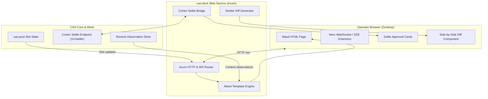

# 0018-mad-stack-operator-deck-and-settle-queue

## Overview

CAS agents execute speculative compute and multi-step workflows. Irreversible
actions (e.g., git push to main, OpenBao secret rotations, cluster deploys) require
human-in-the-loop approval. The estate operator needs a live dashboard to inspect
running agent slots, review diffs, and approve settle cards.

This spec defines the operator interface in `cas-deck`:
- **CER-2733**: Axum web service and Maud compile-time HTML components.
- **CER-2734**: Real-time SSE and WebSocket stream with htmx fragment swap.
- **CER-2735**: Cortex settle queue client (`/v1/settle/pending`) and approval UI.
- **CER-2736**: Interactive split diff viewer and verification evidence badge display.

Parent tickets: CER-2694, CER-2695, CER-2696, CER-2697.

Facts, measured and recorded 2026-10-09:
- **Zero-Node Decision [verified]:** Spec 0001 and research require pure Rust
  MAD stack (Maud, Axum, Datastar/htmx). No Node.js runtime or npm dependencies.
- **Approved Crates [verified]:** Spec 0004 approves `axum` 0.8.9, `maud` 0.27.0,
  `tower-http` 0.7.1, `similar` 3.2.0, and `tokio-stream` 0.1.19 for `cas-deck`.
- **Cortex Settle API [verified]:** Cortex mesh exposes `/v1/settle/pending`
  and `/v1/settle/decision` endpoints over Unix domain socket or local HTTP.
- **Controlled Language [verified]:** UI labels and status badges adhere to
  ASD-STE100 and evidence tier definitions (`verified`, `reported`, `heuristic`, `asserted`).

## Design

### Requirements (EARS)

- **Ubiquitous:** The `cas-deck` dashboard shall render operator UI components using Axum and Maud without Node.js dependencies.
- **Ubiquitous:** The dashboard shall display verification evidence tiers with standard badge colors (Green for `verified`).
- **Event-driven:** WHEN an operator submits a settle card decision, `cas-deck` shall forward the decision to Cortex.
- **State-driven:** WHILE streaming slot telemetry, the dashboard shall push live updates over Server-Sent Events to htmx frontends.
- **Unwanted behavior:** IF communication with Cortex fails, THEN the dashboard shall display an error notification and prevent submissions.

### Decisions

| # | Decision | Who, when |
|---|---|---|
| D1 | Pure Rust hypermedia: Render all HTML at compile time with `maud` macros. Serve via `axum` routes with `htmx` for dynamic browser updates. | Spec 0001 & the operator, 2026-10-09 |
| D2 | Real-time event transport: Use Server-Sent Events (`GET /events`) for slot lifecycle telemetry and WebSocket for bidirectional settle actions. | CAS lane, 2026-10-09 |
| D3 | Cortex settle integration: Poll and stream pending settle items from Cortex. Provide one-click Approve, Reject, and Request-Info actions. | CAS lane, 2026-10-09 |
| D4 | In-process diff rendering: Compute syntactic diffs using `similar` 3.2.0. Render side-by-side unified diffs with line numbering in pure Maud. | CAS lane, 2026-10-09 |
| D5 | Evidence badge hierarchy: Display colored badges for evidence tiers: Green (`verified`), Blue (`reported`), Yellow (`heuristic`), Gray (`asserted`). | AGENTS.md rule 3 & CAS lane, 2026-10-09 |
| D6 | Asset bundling: Embed minimal CSS and `htmx.min.js` directly into the binary using `include_str!`. Zero runtime external network dependencies. | CAS lane, 2026-10-09 |

### Architecture and Flow



### Components

#### 1. Axum Web Service & Maud Templates (`server.rs`, `views/`)
- HTTP service listening on configurable address (default `127.0.0.1:3000`).
- Routes:
  - `GET /`: Main dashboard view showing active slots, memory usage, and settle queue.
  - `GET /slots`: Fragment returning active worker slot table.
  - `GET /settle`: Fragment returning pending settle approval cards.
  - `GET /diff/:card_id`: Modal fragment showing side-by-side diff.
  - `POST /settle/:card_id/approve`: Submits operator approval to Cortex.
  - `POST /settle/:card_id/reject`: Submits operator rejection with note.
  - `GET /events`: SSE stream carrying live slot state transitions.

#### 2. Live Fragment Streaming (`events.rs`)
- Uses `axum::response::sse::Sse` and `tokio_stream::wrappers::BroadcastStream`.
- Broadcasts typed domain events (`SlotAllocated`, `SlotFrozen`, `SettleQueued`, `SettleResolved`).
- Maud renders HTML fragment directly into SSE data payload.
- Browser `htmx` swaps targeted DOM elements without page reload.

#### 3. Cortex Settle Bridge (`settle.rs`)
- Connects to Cortex mesh settle queue via local IPC or HTTP client.
- Fetches pending items: `id`, `lane`, `summary`, `action_type`, `evidence_tier`, `diff`.
- Actions supported:
  - `Approve`: Releases gated workflow branch or lands PR.
  - `Reject`: Aborts execution or rolls back compensation saga.
  - `Hold`: Requests additional test evidence or operator review.

#### 4. Diff Engine & Evidence Display (`diff.rs`)
- Takes base text and modified text from candidate changeset.
- Computes character and line diffs via `similar::TextDiff`.
- Maud generates HTML table with red/green background highlight.
- Evidence badges show verification provenance and test command.

### Invariants

1. **Air-Gapped Operation:** Dashboard serves all styles, scripts, and fonts locally without external CDN requests.
2. **Operator Exclusivity:** Settle actions reject automated requests missing human session authentication tokens.
3. **Fail-Closed Gate:** If Cortex settle service is unreachable, deck displays disconnected warning and disables approval actions.
4. **Host Throttling:** Axum server handles concurrent browser sessions without exceeding 2 worker threads on host `ceres`.

### Errors

- `DeckError::ServerBindFailed`: Port already in use or permission denied.
- `DeckError::CortexUnavailable`: Failed to connect to Cortex settle queue.
- `DeckError::InvalidSettleId`: Referenced card ID does not exist.
- `DeckError::DiffComputationFailed`: Text encoding error or oversized diff payload.

## Plan

- [ ] Add `axum = { version = "0.8.9", features = ["ws"] }` to workspace dependencies.
- [ ] Add `maud = { version = "0.27.0", features = ["axum"] }` to workspace dependencies.
- [ ] Add `tower-http = { version = "0.7.1", features = ["fs", "trace"] }` to workspace dependencies.
- [ ] Add `similar = "3.2.0"` to workspace dependencies.
- [ ] Implement `cas-deck::views` layout and component templates.
- [ ] Implement `cas-deck::server` Axum routing and static asset handlers.
- [ ] Implement `cas-deck::settle` Cortex queue consumer and action dispatcher.
- [ ] Implement `cas-deck::diff` syntax and line-diff generator.
- [ ] Integration tests:
  - GET `/` returns HTTP 200 with valid HTML structure.
  - Settle approval dispatches correct decision payload to mock Cortex service.
  - Diff view correctly classifies insertions, deletions, and unchanged lines.
- [ ] Update `specs/README.md` and roadmap artifacts.

## Test

```bash
cargo test -p cas-deck -j 2
```

## Notes

- **MAD Stack Philosophy:** Maud compiles HTML into native Rust machine code.
  Templates have zero runtime parsing overhead and complete compile-time type safety.
- **htmx Integration:** Minimal client footprint (<15KB compressed) provides SPA-like
  responsiveness while server maintains all state.
